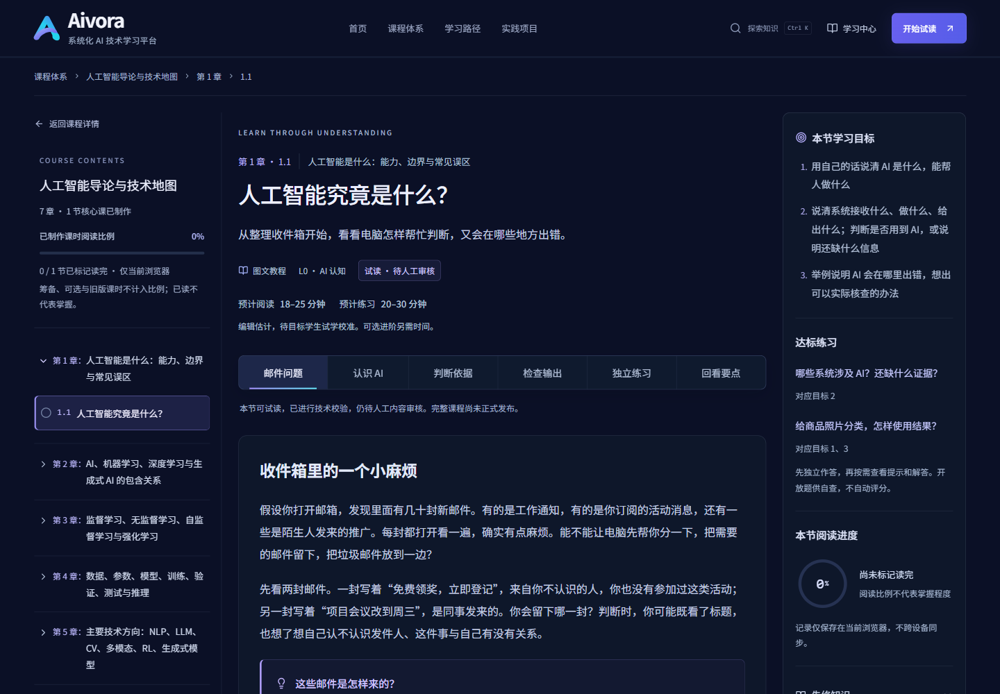
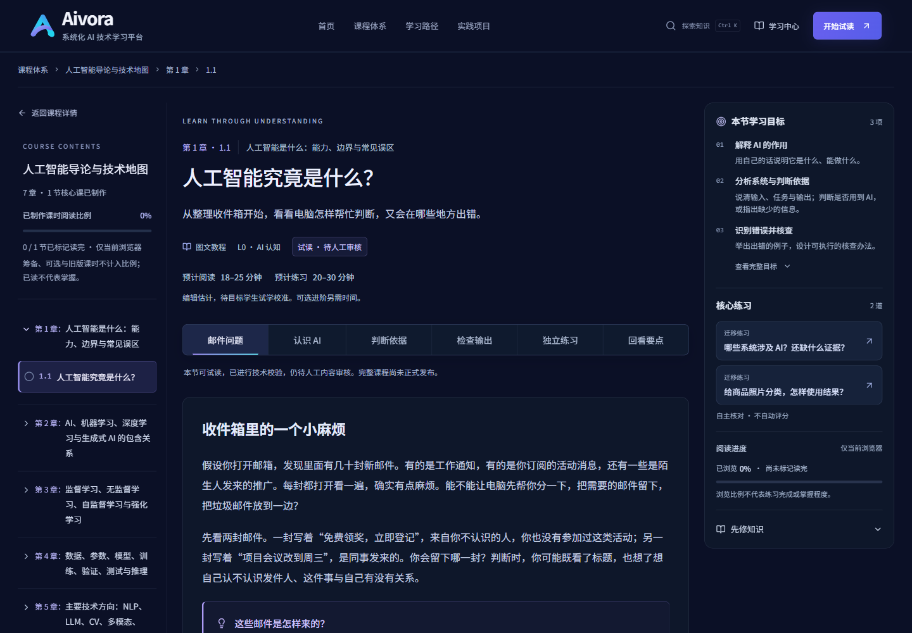

# 阅读器学习面板视觉验收 · 2026-10-26

本轮完成右侧学习面板与「本节导航」Drawer 的视觉重设计。开始及提交前均 fetch 最新 main，基线为 `cdd7869960b12a0683f3621ce507e69f33c81bf3`。改前在真实浏览器检查开发页面，改后检查 `next build` / `next start` 生产页面；同尺寸截图保存在 [screenshots/learning-panel-2026-10-26](screenshots/learning-panel-2026-10-26)。

## 问题根因

- CSS 已加载，并非整份样式缺失。浏览器 CSSOM 存在学习面板规则，computed background、border、padding 与规则一致；页面缩放 scale=1，元素 zoom=1。
- `teaching-v2-2.css` 后加载的三栏规则覆盖 `reader.css`：桌面使用 `270px / 760px / 264px`。右栏还受滚动条和内边距影响，目标文本可用宽度约 196px；1366px 仍强行三栏。
- 旧目标字号 14px、行高 26.6px，组标题 15px，缺少条目标题层级。练习只有普通链接：padding=0、border=0、background=transparent；对应目标编号、说明和大圆环占据高度，AI000 的先修入口被推到首屏之外。
- Drawer 通过 portal 位于阅读器外，不能继承 `.reader-layout` 的局部 token。旧面板的背景/边框 fallback 实际生效，没有因此变成无样式页面；此次将面板 token 就地定义，避免未来依赖阅读器祖先。

原始记录：[改前 computed styles / 命中规则](screenshots/learning-panel-2026-10-26/before-styles.json)、[改前布局](screenshots/learning-panel-2026-10-26/before-layout.json)、[改后 28 组 computed styles](screenshots/learning-panel-2026-10-26/after-computed-styles.json)。记录包含字号、行高、padding、gap、border、background、width、overflow 与样式表信息。

## 实现与内容边界

1. **学习目标**：中性编号 + 短标题 + 简短解释。四个验收课时在自身 Lesson 中增加可选 `objectiveDisplay`；每项以正式目标完整原文绑定，Schema 拒绝未知、重复、过期绑定。展开「查看完整目标」可读全部原文；未配置的课时直接显示原文，不截断、不自动猜测摘要。PY101 5.1 实际有两项目标，未补造第三项。
2. **核心练习**：独立整卡链接，从现有 assessmentMap 与 exercise blocks 推导、按原规则去重，练习类型来自正文 block。保留原题名与锚点，用背景、细边框、跳转箭头、hover 和 Cyan focus-visible 表达可点击性。对应目标编号不再铺在卡片中，可选拓展仍有折叠入口。
3. **阅读进度**：4px 横条 +「已浏览 N% · 尚未标记读完 / 已手动标记读完」。明确浏览不代表练习完成或掌握，不新增答题状态。
4. **先修知识**：默认折叠的一行入口，展开后保留完整说明和原有补修链接。

面板沿用深海军蓝，Indigo/Violet 用于少量状态，Cyan 用于键盘焦点；标题 14px，目标/卡片标题 13px，解释 12px，辅助信息 10–11px。分组之间 16px 间距及细分隔线，卡片最小高度 62px。长中文自然换行。Drawer 的文章目录默认折叠，标题和关闭按钮固定，内容独立滚动。

对改前导出的完整 lessonRegistry 做深比较：**全部 24 个已注册 Lesson 除可选 objectiveDisplay 外完全相同**。正文、正式目标、assessmentMap、先修、课程/课时/section/练习 ID、contentVersion、发布清单和存储作用域未改。

## 实际响应式检查

每个宽度均检查 AI000 1.1、MA101 2.1、PY101 5.1、ML201 4.3，共 **28 组生产页面**；以下正文宽度取 AI000 的实际测量并四舍五入。

| 浏览器视口 | 正文宽度 | 学习面板表现 | 四课检查结果 |
| --- | ---: | --- | --- |
| 1920 × 1080 | 820px | 300px sticky 右栏 | 通过，无横向溢出 |
| 1440 × 1000 | 785px | 300px sticky 右栏 | 通过，正文比改前 760px 更宽 |
| 1366 × 900 | 820px | 两栏正文；学习面板进入 400px Drawer | 通过，不再挤三栏 |
| 1024 × 900 | 713px | 两栏正文；400px Drawer | 通过，目录仍可访问 |
| 768 × 1024 | 713px | 单栏正文；400px Drawer | 通过，章节目录/本节导航均可打开 |
| 390 × 844 | 347px | 370px Drawer | 通过，AI000 默认四组同屏；其他长内容可滚动 |
| 320 × 740 | 285px | 300px Drawer | 通过，长标题换行，展开先修后关闭按钮仍可见 |

逐图检查结果：四组边界清晰；目标标题与解释有层级；卡片背景、边框、箭头均实际显示；阅读状态无完成歧义；没有样式回退、页面或卡片横向溢出。1920/1440 使用 sticky；1399px 及以下降级为 Drawer。AI000 桌面面板高度约 705px，四组可同时辨认。

### 同尺寸前后对比

| 课时（实际内部 ID） | 1440 × 1000 | 390 × 844 |
| --- | --- | --- |
| AI000 1.1 · AI000-C01-L01 | [改前](screenshots/learning-panel-2026-10-26/before-AI000-1440.png) / [改后](screenshots/learning-panel-2026-10-26/after-AI000-1440.png) | [改前](screenshots/learning-panel-2026-10-26/before-AI000-390.png) / [改后](screenshots/learning-panel-2026-10-26/after-AI000-390.png) |
| MA101 2.1 · MA101-C02-L03 | [改前](screenshots/learning-panel-2026-10-26/before-MA101-1440.png) / [改后](screenshots/learning-panel-2026-10-26/after-MA101-1440.png) | [改前](screenshots/learning-panel-2026-10-26/before-MA101-390.png) / [改后](screenshots/learning-panel-2026-10-26/after-MA101-390.png) |
| PY101 5.1 · PY101-C05-L01 | [改前](screenshots/learning-panel-2026-10-26/before-PY101-1440.png) / [改后](screenshots/learning-panel-2026-10-26/after-PY101-1440.png) | [改前](screenshots/learning-panel-2026-10-26/before-PY101-390.png) / [改后](screenshots/learning-panel-2026-10-26/after-PY101-390.png) |
| ML201 4.3 · ML201-C04-L04 | [改前](screenshots/learning-panel-2026-10-26/before-ML201-1440.png) / [改后](screenshots/learning-panel-2026-10-26/after-ML201-1440.png) | [改前](screenshots/learning-panel-2026-10-26/before-ML201-390.png) / [改后](screenshots/learning-panel-2026-10-26/after-ML201-390.png) |

AI000 1440px，改前：

AI000 1440px，改后：

### 其余尺寸的截图

| 宽度 | AI000 改前 / 改后 | MA101 改后 | PY101 改后 | ML201 改后 |
| --- | --- | --- | --- | --- |
| 1920 | [前](screenshots/learning-panel-2026-10-26/before-AI000-1920.png) / [后](screenshots/learning-panel-2026-10-26/after-AI000-1920.png) | [查看](screenshots/learning-panel-2026-10-26/after-MA101-1920.png) | [查看](screenshots/learning-panel-2026-10-26/after-PY101-1920.png) | [查看](screenshots/learning-panel-2026-10-26/after-ML201-1920.png) |
| 1366 | [前](screenshots/learning-panel-2026-10-26/before-AI000-1366.png) / [后](screenshots/learning-panel-2026-10-26/after-AI000-1366.png) | [查看](screenshots/learning-panel-2026-10-26/after-MA101-1366.png) | [查看](screenshots/learning-panel-2026-10-26/after-PY101-1366.png) | [查看](screenshots/learning-panel-2026-10-26/after-ML201-1366.png) |
| 1024 | [前](screenshots/learning-panel-2026-10-26/before-AI000-1024.png) / [后](screenshots/learning-panel-2026-10-26/after-AI000-1024.png) | [查看](screenshots/learning-panel-2026-10-26/after-MA101-1024.png) | [查看](screenshots/learning-panel-2026-10-26/after-PY101-1024.png) | [查看](screenshots/learning-panel-2026-10-26/after-ML201-1024.png) |
| 768 | [前](screenshots/learning-panel-2026-10-26/before-AI000-768.png) / [后](screenshots/learning-panel-2026-10-26/after-AI000-768.png) | [查看](screenshots/learning-panel-2026-10-26/after-MA101-768.png) | [查看](screenshots/learning-panel-2026-10-26/after-PY101-768.png) | [查看](screenshots/learning-panel-2026-10-26/after-ML201-768.png) |
| 320 | [前](screenshots/learning-panel-2026-10-26/before-AI000-320.png) / [后](screenshots/learning-panel-2026-10-26/after-AI000-320.png) | [查看](screenshots/learning-panel-2026-10-26/after-MA101-320.png) | [查看](screenshots/learning-panel-2026-10-26/after-PY101-320.png) | [查看](screenshots/learning-panel-2026-10-26/after-ML201-320.png) |

## 交互、兼容性与验证

- Tab 聚焦练习整卡，2px Cyan focus-visible 清晰；Enter 跳转后 Drawer 关闭，焦点落到真实练习 H3，目标未被固定导航遮住。[键盘截图](screenshots/learning-panel-2026-10-26/keyboard-card-focus-320.jpg)
- Esc 恢复到「本节导航」按钮；Shift+Tab 从关闭按钮回到 Drawer 内最后一个先修入口，焦点没有逃逸。文章目录跳转、可选验证展开、完整目标展开均正常。
- 旧 `#assessment-title` 在 1366px 自动打开 Drawer；直接访问 `#exercise-sequential` 定位并聚焦原练习。已有版本化存储键和历史锚点的回归测试通过。
- 鼠标 hover 的背景实际从 `rgb(22,34,58)` 变为 `rgb(29,43,72)`，边框同时增强。[hover 截图](screenshots/learning-panel-2026-10-26/exercise-hover-1440.png)
- 320px 展开 ML 长先修，四条真实补修链接均可读、可聚焦；内部滚动时关闭按钮留在顶部。[先修截图](screenshots/learning-panel-2026-10-26/prerequisites-ML201-320.jpg)
- 浏览到 100% 不自动完成；点击正文既有按钮后显示手动完成，刷新仍保留。使用独立 localhost 测试来源，结束后恢复该测试键的空状态。[未标记](screenshots/learning-panel-2026-10-26/progress-100-unmarked-390.jpg) / [已手动标记](screenshots/learning-panel-2026-10-26/progress-100-marked-390.jpg)
- 模拟 `prefers-reduced-motion: reduce`：滚动为 auto，Drawer 无动画，transition 受已有全局规则缩至 0.00001s；新面板没有必须依靠动画才能理解的状态。
- `npm run typecheck`、`npm run lint`、`npm test`（67/67）、`npm run build`（51 个静态页面）、`git diff --check` 通过。生产检查无新增 console error；开发期存在正文图片 LCP 建议和 Fast Refresh 提示，不涉及面板样式。

交互原始结果：[interaction-checks.json](screenshots/learning-panel-2026-10-26/interaction-checks.json)。真实检查环境是 Windows 上的 Chromium 内嵌浏览器，尺寸为浏览器视口；未声称完成 Safari、Firefox、iOS 实机或屏幕阅读器认证。截图由 AI 辅助逐图审读，不替代专业人工审稿或目标学生试学；课程原有待审状态不变。

## 修改文件

- 布局与视觉：`src/app/reader.css`、`src/app/teaching-v2-2.css`。
- 呈现与 Drawer：`src/components/lesson/learning-support.tsx`、`reader.tsx`、`article-contents.tsx`，以及 `src/components/ui.tsx` 的可选 Drawer className。
- 数据展示绑定：`src/content/models.ts`、`src/lib/lesson-exercises.ts`；四课的 `ai000/what-is-ai.ts`、`ma101/vector-meaning.ts`、`foundations-v2-1.ts`、`ml201/manual-update.ts`，及 MA/ML shared 输入类型。
- 回归测试：`tests/reading-experience.test.ts`。本报告和截图/测量记录随代码提交。

没有改动其他页面业务、教材正文、内容版本或课程生产状态。工作区原有 `next-env.d.ts` 等未提交文件不纳入本次提交。
