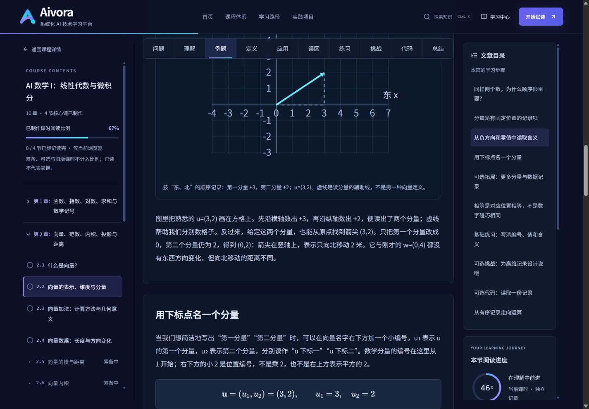
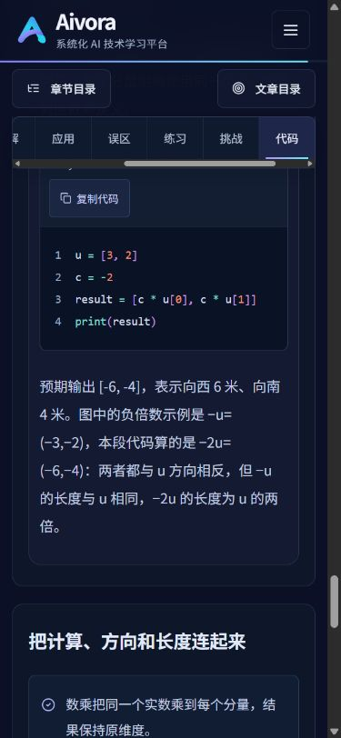

# MA101 2.1–2.4 编辑审查 V1

日期：2026-10-26（Asia/Shanghai）。实际基线：`51a03bf1c00440c6deeb66300175389cd2b7238b`，fetch 后本地与 origin/main 一致。四篇已是 V2.3 现稿，本轮没有拿 V2.2 的问题清单覆盖当前修改。

这是按初学者阅读顺序逐段检查、重新计算和实页操作的 **AI 辅助编辑审读**，不是人类审稿者签署的专业审核，也没有真实学生试学。未发现已确认的实质数学错误；已修局部重复、一步省略和图文衔接，剩余题目效度问题交给人工。课程继续为 `pending-review/preview`，不填 `reviewEvidence`。

## 标准、基线与本轮范围

- [编辑规范 V1.0](COURSE_EDITORIAL_STANDARD_V1.md)：收入用户 2026-10-26 原稿，保留“规范草案”状态；仅补仓库入口、简报稳定锚点，并把简报 `exerciseId` 适配为现有 `exerciseIds` 数组。附件 SHA-256：`2C3C9E5583494C09CDABAFC0E9F50297BC03878BC75E9189EB5A4FFB6BF07DD9`。
- [工程指南](COURSE_AUTHORING.md)、[生产与审校工作流](COURSE_PRODUCTION_WORKFLOW.md)、[单课提示词](COURSE_GENERATION_PROMPT.md)：先做简报和事实表，再写课、独立重算，最后交接人工审校/试学。README 同时提供入口，修正其仍允许正文 n.m.k 编号的过期说明；AGENTS.md 在 Next 自动生成区块之外加入课程任务必读入口，便于以后每次 Codex 编写课程时使用。
- 已读原课程体系 Markdown/JSON、现行节级蓝图、四篇正文及全部题目/提示/答案、`lessonSchema`、`assessmentMap`、发布清单、课程注册/导航与进度、SVG 数据和实现、现有 TS/Python 测试及 V2.3 审查。按 AGENTS 阅读本地 Next 的 linking-and-navigating 与 testing 指南。
- [本轮实际改前全文](editorial-v1/TEACHING_V2_3_BEFORE.json) 在修改前从 HEAD 导出，不覆盖 [历史 V2.3 审查](TEACHING_V2_3_REVIEW.md) 及其 V2.2 快照。[本轮前后全文](editorial-v1/TEACHING_V2_3_COMPARISON.json) 与 [目标/层级矩阵](editorial-v1/TEACHING_V2_3_CONTENT_MATRIX.json) 可逐块复核。沿用旧脚本文件名，内容基线由 JSON 内的 revision 识别。

本轮没有修改 React/CSS、公式、SVG、代码块、题干/提示/答案、目标或难度分层。只编辑四篇的局部说明；课时、section、exercise ID、URL 与 r1 键均保留，教学任务和数学含义未变，因此不重置阅读进度。MA101 发布清单的 `technicalEvidence` 改指本报告，以关联本轮证据；其余课程状态不变。

## 四课的回填编辑简报

以下为对现稿的编辑计划回填，不冒充 V2.3 写作前已有的简报。共用读者画像为 L1 初次学习向量者；主例是为教学构造的配送位移，按东、北排序，东/北为正，单位米。数学核心不要求 Python，可选代码读者需先会列表。学习时间继续使用现有 reading/practice/coding 编辑估计，未按字数改动推算收益。

| 课时与源稿 | 先修与真实路径 | 核心问题、主例和引入顺序 | 核心与可选边界；本轮编辑重点 |
| --- | --- | --- | --- |
| 2.1 [向量概念](../src/content/lessons/ma101/vector-meaning.ts) | 方向、整数加减和数格子；以 prerequisites 自查，仓库暂无单独方向补修正文 | 为什么移动指令只给“3 米”不够？从时间/温度到位移箭头，主例 (0,0)→(3,2)，再平移 (1,1)→(4,3) | 核心判断标量/向量、区分路程/位移、判断相等；避障信息为可选。只合并紧邻重复说明 |
| 2.2 [表示与分量](../src/content/lessons/ma101/vector-representation.ts) | [2.1](../src/content/lessons/ma101/vector-meaning.ts) 对应真实 `/learn/MA101/MA101-C02-L03`；整数、小数、读格子 | 如何把移动写成可还原的有序记录？(3,2) 的顺序→(−2,3)/(0,4) 的符号→u₁/u₂→维度/编号/值 | n/i、列写法、库存对齐为可选，Python 为 verification。补出只改第一分量后的 (0,2) |
| 2.3 [向量加法](../src/content/lessons/ma101/vector-addition.ts) | 已完成 2.1/2.2，源码回链到真实 L04；整数加减 | 连续两次位移如何合成？(3,2)+(−1,1)→逐方向求和→首尾相接→一般二维规则→换起点/顺序/单位 | 核心为配对加法、几何解释和错配纠正；补偿/避障为可选，列表代码为 verification。补本机运行和预测输入变化 |
| 2.4 [向量数乘](../src/content/lessons/ma101/vector-scaling.ts) | 已完成 2.1–2.3，源码回链到真实 L05；正负/分数乘法 | 同一倍率如何改变分量、方向和长度？重复移动→2/0.5/−1/0→一般式→比例/相似→绝对值 | 反求倍率、位置缩放/共线和分配关系为可选，代码为 verification。解释“相似”，明确图的 −1 与代码的 −2 |

通用术语检查：位移与路程、分量与维度/编号/值、数乘与分量加数、位置与位移在四篇中含义稳定；“合向量/合位移”在位移情境中对应同一计算结果。保留“大小”作为向量长度的入门说法、零向量无确定方向的约定及限定条件，没有按近义词机械统一。

## 有证据的编辑项

优先级：P0 为已确认的事实/推导/答案错误或核心任务阻断；P1 为明显影响核心学习的缺口；P2 为局部表达、衔接或需验证的练习改进。本轮未确认 P0/P1，不把“更喜欢另一种文风”计作缺陷。下表段落按 `section.id` 内 paragraph 顺序定位；完整原文以改前快照为准。

| 编号/优先级 | 源文件、段落及原证据 | 问题及具体改法 | 处理 |
| --- | --- | --- | --- |
| E01 / P2 | [vector-meaning.ts:22](../src/content/lessons/ma101/vector-meaning.ts#L22)，worked 的公式说明：“也不是说斜线长 5 米”；紧接的第 3 段末又说“斜线长度也不等于折线路程 5 米” | 同一局部两次否定没有增加理由。公式说明只解释点、向量与分量；完整路程/位移区分及绕路反例保留在下一段 | 已修；未删关键边界 |
| E02 / P2 | [vector-representation.ts:24](../src/content/lessons/ma101/vector-representation.ts#L24)，worked 第 3 段末：“把第一个分量改成 0……与刚才 w=(0,4) 的读法相呼应” | 省略了新坐标 (0,2)，还要求读者自行分辨它与 (0,4) 的联系和差异；不是原结论算错。补“第二分量仍为 2”及两个竖直位移距离不同 | 已修 |
| E03 / P2 | [vector-scaling.ts:57](../src/content/lessons/ma101/vector-scaling.ts#L57)，code 输出说明：“对照上面的图解……长度为 u 的两倍”；SVG 负倍数面板实际为 −1，代码 c=−2 | 原数学正确，但图里没有 −2 面板，未明说比较的倍率不同。列出 −u=(−3,−2) 与 −2u=(−6,−4)，分别说长度，输出改按实际 ASCII 显示 | 已修；不改图或算法 |
| E04 / P2 | [representation:57](../src/content/lessons/ma101/vector-representation.ts#L57)、[addition:51](../src/content/lessons/ma101/vector-addition.ts#L51)、[scaling:54](../src/content/lessons/ma101/vector-scaling.ts#L54)，原 code 首段分别只说“会 Python 列表时”或“可运行下面最小片段” | 独立阅读课时的读者找不到保存后在哪运行，也不知道是否装 NumPy；README 有环境要求，但代码旁没有。补本机 Python 3.10+、无需第三方库、文件名和终端命令 | 已修；数学核心仍可跳过代码，实测环境见技术证据 |
| E05 / P2 | [vector-addition.ts:55](../src/content/lessons/ma101/vector-addition.ts#L55)，code 原来止于固定输出 [2,3] 的解释 | 可选代码仅复现同一例子，缺少参数变化的预测。增加 v=[1,−1] 的先预测、手算、运行比较任务；未将其新增为核心达标条件 | 已补；独立复核输出 [4,1] |
| E06 / P2，待人工 | [vector-meaning.ts:42](../src/content/lessons/ma101/vector-meaning.ts#L42)，practice 的 same-displacement 与 worked/definition 使用完全相同的甲乙丙坐标 | 学生可能复述例子，当前证据不足以判断陌生数据迁移。建议试学另给 (2,−1)→(4,2)、(−1,0)→(1,3)、(4,2)→(2,−1)，要求比较变化并解释；正确变化应为 (2,3)、(2,3)、(−2,−3) | 保留现有基础题供熟例自查；是否另加/替换新数字题待教师审定，不宣称当前练习无效 |
| E07 / P2 | [vector-scaling.ts:29](../src/content/lessons/ma101/vector-scaling.ts#L29)，diagram 第 3 段首次用“相似的直角三角形”直接推出斜边倍率，prerequisites 未列相似概念 | 术语首次出现时未解释，可能让不熟悉几何词汇的读者卡住。就地解释对应角相等、对应边按同一比例变化，再连接到斜边 | 已补术语含义；保留比例与几何推理，理解是否充分仍待试学 |

其他检查与保留决定：

| 检查面 | 四篇的实际证据与决定 |
| --- | --- |
| 跳步 | 2.1 从坐标到平移有数字追踪；2.2 新下标逐一解释；2.3 同方向累积到一般式有代入；2.4 有重复移动、比例、相似和绝对值。只补 E02/E07，未认定核心推导整体缺失 |
| 标题机械感 | 2.1 application“为什么这种表示值得学习？”较通用，但段落确实解释复用移动指令；各课 worked/definition 标题分别指向本课问题。练习/可选前缀承担层级提示，有用途；保留标题与锚点 |
| 重复提醒 | 2.1 路程/位移在首次解释、回程反例与答案中的复现分别承担定义、零向量和自查功能；2.3 方向预测在算后回顾属于检验；2.4 误区与题目重复用于诊断。除 E01 的紧邻复述外保留 |
| 术语稳定 | 未确认把路程当位移、维度当非零项个数、负数当负长度等错误。E07 属于首次解释不足，不冒充跨段术语矛盾 |
| 图/代码/题目 | 各 SVG 输入与核心例子一致，−1 图与 −2 代码均正确，E03 是衔接澄清。核心题答案与题干一致；可选区未成为核心题先修。核心题目充分性仍需人类审阅 |

## 原句、改句与教学效果预期

以下均来自真实前后稿。机制分析和任务给审阅者提供可检验假设，不是 AI 自评分或学习效果结论。

### 对照一：把解释放在一个完整的位置（E01）

原句（worked 公式说明末句）：

> 它不是把 3 与 2 相加，也不是说斜线长 5 米。

紧接下一段又说：

> 位移箭头只由起终点决定，它的斜线长度也不等于折线路程 5 米。

初学者在公式旁先得到一个否定，读到下一段才得到路线、路程和位移的完整区分，随后再次读相同否定。两处并未提供两种不同理由。改后公式说明为：

> A、B 是位置点；粗体 u 是位移向量的名字。(3,2) 按东、北顺序记录变化，单位都是米。

下一段的路程 3+2=5 米、位移与绕路解释全部保留。预期：先读懂符号，再集中处理路线与位移。试学可要求学习者区分另一条“东 2 米、北 1 米”折线的路程与整体位移，无需提前计算斜线长度；观察能否说明 3 米表示什么。

### 对照二：把只改变一项算出来（E02）

原句：

> 试着把第一个分量改成 0，箭尖就会移到竖轴上，这与刚才 w=(0,4) 的读法相呼应。

这句话要求读者同时补出第二分量不变、结果是 (0,2)，并自行理解它没有变成 w。改句：

> 只把第一个分量改成 0，第二个分量仍为 2，得到 (0,2)：箭尖在竖轴上，表示只向北移动 2 米。它与刚才的 w=(0,4) 都没有东西方向变化，但向北移动的距离不同。

预期：读者能把“共同方向”与“相等向量”分开。试学另给 (5,1)，只改第一分量为零，要求画出/写出 (0,1) 并与 (0,4) 比较，不用本文数字直接考记忆。

### 对照三：分清图中的倍率和代码中的倍率（E03）

原句：

> 预期输出 [−6,−4]，终端负号显示为普通连字符。对照上面的图解，两个负分量对应向西、向南，长度为 u 的两倍。

读者回看图，唯一负倍数面板标 −1，写的是“长度为原来的 1 倍”，需要自己发现代码 c=−2 的差异。两处数学都对，但指代不够明确。改句：

> 预期输出 [-6, -4]，表示向西 6 米、向南 4 米。图中的负倍数示例是 −u=(−3,−2)，本段代码算的是 −2u=(−6,−4)：两者都与 u 方向相反，但 −u 的长度与 u 相同，−2u 的长度为 u 的两倍。

预期：把符号决定方向、绝对值决定长度的两步判断落实到两个具体倍率。试学另给 a=(2,1)，比较 −a 与 −3a 的方向和长度倍率，观察是否把所有负倍数当成同一长度。仍需真实答题过程验证。

### 对照四：解释几何术语，再连接结论（E07）

原句：

> 把两条直角边都乘同一个正数，就得到一个相似的直角三角形，对应斜边也乘同一倍数；斜边正是箭头的长度。

若学生不知道“相似”的含义，“斜边同倍”仍像另一条待记忆结论。改句：

> 把两条直角边都乘同一个正数，就得到一个相似的直角三角形。这里的“相似”指对应角相等、对应边按同一比例变化，所以斜边也乘同一倍数；斜边正是箭头的长度。

预期：能指认哪个三角形、哪条边与向量长度对应。试学用同形三角形的两条直角边同时缩半，让学生说明斜边倍率及理由；若仍不理解，应补几何补修或调整解释，不能据本句断言已教会相似定理。

## 目标、练习与解答逐项复核

实际数据仍为 12 个目标、8 道核心开放题、6 道可选题。各题两级提示、解答、rubric 保持；结构导出可定位到原题全文。下表为重新从题干求解后对照的结果，语义效度尚未获得人类签署。

| 课时 / 目标动作 | 核心题与正文支点 | 独立核对结果 / 需要观察的过程 |
| --- | --- | --- |
| 2.1 / 判断量的类型 | quantity-choice；intuition 表 | 温度/路程为标量，位移/向西速度为向量；需解释方向依据 |
| 2.1 / 区分路程位移 | quantity-choice、same-displacement；worked、mistakes | 回环路程大于零、位移零；绕路起终点不变则位移不变，需说明为何 |
| 2.1 / 平移判断相等 | same-displacement；definition、diagram | 甲乙变化 (3,2)，丙 (−3,−2)；须逐方向比较，熟例迁移问题见 E06 |
| 2.2 / 读写二维分量 | read-components、build-record；worked、definition | a₁=4、a₂=0；北 3→(0,3)，东 2 南 1→(2,−1) |
| 2.2 / 区分维度编号值 | read-components；intuition、definition | (4,0) 二维，零在第 2 项；(4,0,0) 三维，零项仍计数 |
| 2.2 / 正负零含义 | build-record；worked、mistakes | (−2,3) 西 2 北 3；(3,0) 东向与 (0,3) 北向不同；需解释零所在方向 |
| 2.3 / 配对求和 | addition-new、addition-check；worked、definition | (2,−1)+(−3,4)=(−1,3)；第二题转为米且东/北后 (1,2)+(−2,1)=(−1,3) |
| 2.3 / 首尾相接 | addition-new；diagram | 中间点 (2,−1)，第二箭头从此到 (−1,3)，合箭头从原点到最终点 |
| 2.3 / 发现错配 | addition-check；mistakes | 两类错误是单位与顺序；维度不同缺少对应项，不直接配对 |
| 2.4 / 同一倍数乘每项 | scale-values、scale-explain；worked、mistakes | 3a=(6,−3)，−0.5a=(−1,0.5)，0a=(0,0)；甲加 2、乙漏乘，正确 2u=(6,4) |
| 2.4 / 判断方向 | scale-values；diagram | 正倍同向，负倍反向，零无确定方向；题中原 a 非零 |
| 2.4 / 绝对值长度 | scale-values、scale-explain；diagram | 长度倍率分别 3、0.5、0；已知 5 米乘 −2 得 10 米，方向反向 |

六道可选题也逐题核对：route-record 需路径/障碍等额外信息；aligned-record 重排后均 (8,0,5)，箱换件需各商品每箱数量；schema-record 示例四属性及其单位/原点约定成立；missing-leg 解出 (−3,4)，不保证避障；one-factor 对应 −2、冲突的 2/1、零项不可能变 1；scale-sum 两种计算均 (2,4)，一般理由来自两个实数分量的分配律。未发现题干、解答或 rubric 的实质矛盾；选择题不是本轮核心目标的唯一证据。

## 事实与素材来源登记

本轮访问日期均为 2026-10-26。来源用于核对定义与运算，没有复制外部教材段落、图片或代码。附件中的其他候选来源未在本轮全部重审，不冒称都已核实。

| 来源与版本 | 核对点 | 复用/许可记录 |
| --- | --- | --- |
| `curriculum/AI技术课程体系_V1.0.md`、JSON 与 `math-outline.ts`，提交 51a03bf | MA101 L1、章级目标、先修、独立课顺序与稳定 ID | 原有课程事实，未改写 |
| [OpenStax Calculus Volume 3 §2.1](https://openstax.org/books/calculus-volume-3/pages/2-1-vectors-in-the-plane)、[§2.2](https://openstax.org/books/calculus-volume-3/pages/2-2-vectors-in-three-dimensions) | 自由向量相等、零向量、分量加法和数乘；自身例题另行计算 | 仅参考链接及数学规则。所访问页脚标注 CC BY-NC-SA；未因此认定可商业复制，未来复用原文/图需另行确认。原有效参考链接保留 |
| [Python 3.14 官方列表教程](https://docs.python.org/3.14/tutorial/introduction.html#lists) | 列表零起始索引与 `+` 拼接，和网页三段程序对照 | 只核语义；片段沿用仓库代码，没有复制教程代码。实际运行 Python 3.14.2；3.10+ 为教材环境要求，不声称全部版本已实测 |
| [CMU Eberly Center：目标、测评与教学对齐](https://www.cmu.edu/teaching/assessment/basics/alignment.html) | 根据目标动作检查任务，而非仅存在映射 | 链接参考，未复用页面图或大段文字；不据此认定本课已经有效 |
| `vector-teaching.ts`、`vector-figure.tsx` 与现有数值测试，当前稿 | 图端点与等比例映射，零倍数只画点，代码/图/例题对应 | 原有程序 SVG 与教学构造数据；没有新增第三方素材 |

## 技术与页面实测证据

本轮实测 Node.js 24.16.0、npm 11.13.0、Next.js 16.4.3、Python 3.14.2、NumPy 2.5.2。没有新增依赖或把环境要求写成全版本验证承诺。生产验收仅监听 127.0.0.1:3001，完成后停止本轮进程。

| 检查 | 本轮实际结果与证据 |
| --- | --- |
| TypeScript / Lint | 均 exit 0：[类型输出](editorial-v1/TYPECHECK.txt)、[Lint 输出](editorial-v1/LINT.txt) |
| TS 回归 | 52/52 通过，含严格 KaTeX、层级/映射、原 URL/ID、r1 与进度兼容：[测试输出](editorial-v1/TEST_RESULTS.txt) |
| 同源下载 / Python | 15 组下载再生成，无资源差异；25/25 Python 单测、37 段网页 Python 全部执行、11 组核心/完整版一致：[下载输出](editorial-v1/DOWNLOADS.txt)、[Python 证据](editorial-v1/TEACHING_V2_3_PYTHON_RESULTS.json) |
| 数学与图/代码衔接 | 原数值测试继续通过；本轮从输入另算 (0,2)、新输入加法、−u/−2u 平方长度、拟议试学坐标、单位与分数，共 9 项补充核对：[独立计算](editorial-v1/INDEPENDENT_CHECKS.json)、[SVG 输入快照](editorial-v1/TEACHING_V2_3_MATH_EVIDENCE.json)。不把相同生成器输出当作唯一校验 |
| 结构与差异留证 | `review:teaching` 输出 23 篇教材的实际矩阵；`review:editing` 以 51a03bf 为本轮改前稿，全量保留四篇原 40 个 section、14 个 exercise ID、r1，代码块/目标/题目/分层未改。见本报告开头的前后全文和矩阵 |
| 生产构建 / HTTP | 构建 exit 0，生成 50 个静态页面；69/69 可读路由与规划/错误归属 404 通过：[构建输出](editorial-v1/BUILD.txt)、[路由证据](editorial-v1/TEACHING_V2_3_ROUTE_RESULTS.json) |
| 修改页排版 | 四篇分别检查 1440×1000、768×1024、390×844，共 12 次：单一 H1，正文 H2 无多级编号，无失效 hash、KaTeX 错误或整页横溢；[浏览器记录](editorial-v1/BROWSER_RESULTS.json) |
| 实际交互 | 11 项记录覆盖桌面目录/正文定位、手机课程/文章抽屉、Escape 焦点恢复、相邻课、可选代码展开、代码复制、两级提示/答案键盘展开、旧 `#exercise-one-factor` 自动展开与刷新恢复。复制首次读取早于异步写入完成，随后重新复制并读取到逐字一致的代码；未将首次空读误报成通过 |
| 证据路径与基线保护 | 四个既有命令新增可选 `AIVORA_EVIDENCE_DIR`，默认路径保持；MA 对比另支持 `AIVORA_EDITING_BASELINE`。实测自定义目录，重复创建基线按预期报 EEXIST 且原 SHA-256 未变：[保护记录](editorial-v1/PIPELINE_CONTRACT.json)。历史 V2.3 文件无修改 |
| 文档与兼容复核 | 本地文档链接可达，9 段引用均逐字匹配真实前后稿；确认规范只包含已说明的入库适配，并逐项比较原目标、题目、代码、公式、图和 ID：[核对记录](editorial-v1/DOCUMENT_COMPATIBILITY_CHECKS.json)。这是出处与兼容检查，不是教学质量评分 |

只保存以下两张与改句有关的截图，未改渲染而新增大批截图。画面内已有阅读百分比是该浏览器的阅读记录，未生成学生数据或新的“读完”标记。

| 桌面分量例子的实际改句 | 手机代码与图的倍率对照 |
| --- | --- |
|  |  |

浏览器只覆盖一个内置 Chromium 引擎的视口模拟，未覆盖实体设备或屏幕阅读器。没有改动前端渲染，因此不重建整站视觉基线，也没有新增逐字检查文案的测试。技术通过不证明例子难度、练习充分性、阅读时间或教学效果；人类任务见下表。

## 待人工审核与目标学生试学

目前没有真实审稿人签名或试学者数据。以下是可执行待办，负责人尚未指派；这些缺口不由 AI 审读或测试结果补齐。

| 待办 | 责任角色与输入 | 需要留下的证据 | 状态 |
| --- | --- | --- | --- |
| H1：四篇逐段学科复核 | 具备线代基础教学能力的教师；当前稿、改前稿、目标表与 14 道题 | 每课事实/推导/符号/单位/答案意见、稿件提交、姓名和日期；确认 E03/E07 澄清是否充分 | 待人工审校 |
| H2：中文及题目效度 | 教学编辑/教师；重点 E06、新旧数字任务及两级提示 | 原句定位、保留/修改理由；判断 same-displacement 是否需新数字题，提示是否过早暴露答案 | 待人工审校 |
| S1：2.1/2.2 无人补讲试学 | 符合先修但未学向量的自愿学习者，组织者待定 | 匿名先修记录；用新数据区分路程/位移、平移相等、(0,1)/(0,4)、维度/编号/值；保留无提示/逐级提示过程和卡点 | 未开展 |
| S2：2.3/2.4 无人补讲试学 | 同上，先完成前节 | 新数字首尾相接与单位重排；−a/−3a 的方向、长度倍率及相似理由；记录可选区是否打断、数学读者是否误以为必须运行代码 | 未开展 |
| S3：时间与修订 | 试学组织者、维护者 | 阅读/练习/代码分项实测及样本范围，补讲记录；有足够证据后才校准编辑估计，不提前制造分布或通过率 | 未开展 |
| H3：审定状态 | 维护者，收到真实 H/S 证据后 | 绑定实际修订的 reviewEvidence、试学结论、剩余事项与发布决定；不只填非空路径 | 待前序完成 |

本轮没有增加课程系统、AI/运行时模型 API、视频、支付、账号、后台 CMS 或在线 Python；Aivora 与 AI Foundry 独立。没有删除文件、历史报告、有效链接或用户工作区已有附件与截图。
