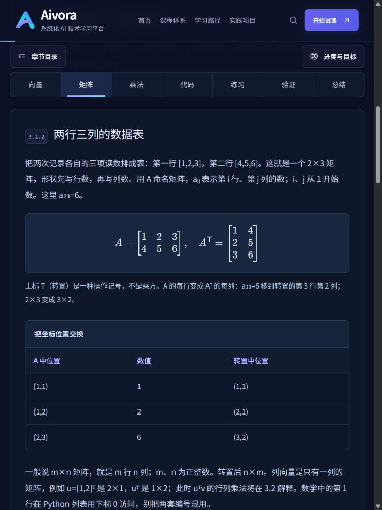

# Aivora V2.1 内容质量审查与技术验收

审查日期：2026-10-26（Asia/Shanghai）。基线为 fetch 后的 main / origin/main `9dc20af`。本次在既有课程引擎、品牌界面与分层目录上增量实施，没有从旧版重建。

**结论：已完成本轮内容重编与列明的技术验收，继续保持“试读 · 待人工审核”。未开展独立人工教学审阅、目标学生试学或正式发布。** 测试、图示核对、浏览器操作和本报告的编辑判断不构成教学质量达标证明。

## P0：知识负荷审查

完整问题与原始证据见 [知识负荷清单](TEACHING_V2_1_AUDIT.md)。本轮优先解决四类问题：单节概念过多、数学符号先于具体数值、工程验证挤占核心实现、选择题不能覆盖编写与分析技能。

审查覆盖原有全部 10 节教材，以及 PY 第 5 章、MA 第 2–3 章、ML 第 3–4 章节级蓝图。ML 3.2 与 4.3 的场景、手算表、错误对照、先预测后验证与结论边界保留；仅补充估计时间、目标映射和必要的开放验收题。

## P1：通用数据与界面

| 改动 | 已实现的行为 | 证据 / 限制 |
| --- | --- | --- |
| 核心与可选层级 | section.tier 为 core、advanced、verification；后两者由原生 details/summary 默认折叠 | Enter/Space 开合，键盘焦点可见；导航与旧 hash 自动展开并定位。未做屏幕阅读器实测 |
| 目标与练习 | assessmentMap 引用真实开放题；schema 拒绝缺失目标、未知题目和仅以进阶题验收核心目标 | 19 节、47 个目标均有结构映射。题目效度和覆盖充分性还需人工判断 |
| 提示与解答 | 每道开放题至少两级提示、参考解答、自查评分标准；基础与进阶区域分开 | 不自动评分、不执行用户代码；输入只在当前页暂存 |
| 分项时间 | learningTime.reading / practice / coding 三个区间；删除旧 durationMinutes 展示与教材字段 | 全部明确标为编辑估计，未伪造学生用时。核心课估计不含可选拓展；可选整节另有说明 |
| 共享术语 | glossary.ts 含输入、特征、目标、标签、预测、误差、残差、损失、参数、权重、偏置、梯度、学习率、迭代、收敛、训练、验证、测试、泛化 | 误差统一 prediction−target；带符号误差、聚合损失、独立数据表现分开。必要符号仍在正文首次出现处解释 |
| 代码分离 | 短核心代码在正文，复杂断言、异常、独立求解器在验证区或下载 | 10 个基础程序直接以核心源码拼接验证；ML 核心与完整版嵌入同一个 regressionStepCode |
| 阅读统计 | 整节 optionalLesson 同步登记于 Lesson 与 Publication；可选课不计基础阅读分母 | 可选阅读与旧版记录仍保留在最近历史；阅读比例不作为掌握认证 |

## P2：逐节重构与达标任务

现为 18 节现行试读（17 节核心、1 节整节可选），另保留 1 节旧综合试读，共 19 节。所有课程仍为规划状态，未把样章开放等同整门课发布。

| 课时 | 核心范围 / 重构结果 | 主要开放验收 |
| --- | --- | --- |
| PY 5.1 / 原 C05-L01 | 定义、调用、一次数值输入和最小 return；原参数和默认值锚点保留为简短回顾 / 衔接 | 独立编写 double，用 4、−2 测试并解释执行时机 |
| PY 5.2 | 位置与关键字绑定，不混入星号、注解和复杂异常 | 用两种方式计算 2×5，写绑定表 |
| PY 5.3 | 返回值、print、None 与调用组合 | 从 5 连续加一到 7，区分屏幕与变量中的值 |
| PY 5.4 | 数值形参、局部名字、函数内外作用域 | 外部 20、输入 4，追踪输出 6 与 20；避免泛化到列表原地修改 |
| PY 5.5 | 简单数字默认值，省略与覆盖 | 预测省略、倍率 3、倍率 0，独立写函数 |
| PY 5.6（可选） | 共享默认列表、显式列表复制、仅限关键字、类型注解和异常 | 安全列表函数；解释两类绑定错误和注解边界 |
| MA 2.1 | 分量、加法、数乘与几何位移 | 新数字手算和终点解释 |
| MA 2.2 | 内积先用总价与乘积表，再引入下标、n、Σ 上下界；不要求先懂转置 | 展开三项求和，判断结果为标量 |
| MA 3.1 / 原 C03-L01 | 只教矩阵行列、元素位置与转置；原 vectors/multiply 锚点保留回顾与衔接 | 新矩阵形状、指定元素、转置与位置交换 |
| MA 3.2 | 行列内积逐格计算后再给一般式；解释 i、j、k、n、m、p | 手算新的 2×3 与 3×2 乘积，判断反向形状 |
| MA 3.3 | 一维与二维表示、reshape、转置、@ 与 *；广播风险与旧完整脚本作为验证 | 新数组内积 / 逐项乘积，列与行的形状 |
| ML 3.1 | 保留传感器读数案例与合成数据边界，补充输出类型题 | 任务迁移、回归 / 分类判断、插值条件 |
| ML 3.2 | 保留成熟的参数对照、三行手算与改代码实验 | 参数改变与数据 / 参数 / 预测角色辨析 |
| ML 3.3 | 帽号、样本下标、平方上标、Σ 上下界逐项说明；先算 5/3、11/3 再用公式压缩 | 换直线手算；解释大误差敏感性与独立评价需求 |
| ML 4.1 | 保留导数差商和小步方向；补充新平方函数推导及零导数反例 | 求 G′、反向起点更新、学习率比较与 H(θ)=−θ² 反例 |
| ML 4.2 | 不再把“已经会偏导”作为隐含先修；先给 x=2、y=5 的参数扰动和链式数值，再介绍 ∂、∇、梯度列向量、t 与 η | 固定量解释、两层推导、同一旧误差的同步顺序 |
| ML 4.3 | 原手算 / 错序更新 / 数据复制设计保留，增加新目标 y=[2,4] 的完整一轮 | 梯度 −10、−6，更新到 1、0.6，新 MSE=1.06 |
| ML 4.4 | 核心预测片段 8 行、核心训练 18 行；45 行完整版及 12 行独立实验分别折叠 | 公式与变量对应、独立补全循环、评价训练下降的结论范围 |
| 旧 ML C04-L01 | 原 URL、七个 section、算法与下载保留；补充分项估计及开放自查 | 参数、梯度、代码、学习率四类自查；不计现行课程完成比例 |

每个目标的题目 ID、类型、题干、提示数量、评分项、时间与分层代码行数均在 [内容矩阵](TEACHING_V2_1_CONTENT_MATRIX.json)，可运行 `npm run review:teaching` 重建。该矩阵用于人工逐项复核，不输出 AI 教学评分。

### 教学图与数学核对

保留既有向量加法、ML 损失、梯度方向、训练曲线等精确图。新增函数执行、矩阵乘法四格演算、NumPy 形状三组图，每组有桌面 / 手机独立构图，共 6 个新增 PNG。脚本 `render-v2-1-diagrams.py` 使用实际 NumPy 数组与标量规则生成表达式和结果，输出 [数值证据](../public/learning/v2-1/numeric-evidence.json)；6 图均经目视检查。页面提供 alt、图注和原图入口，没有用 AI 装饰性生图替代数学。

独立 Python 核对覆盖：MA 新手算题、矩阵转置 / 乘积与反向形状；ML 4.2 数值偏导有限差分、20.25 的新损失；4.3 / 4.4 新目标数据首步 1.06 与最终 y=2x；原有平均 MSE、链式梯度、同步更新、错序反例、学习率实验与最小二乘参考均保留。

### 术语和来源复核

所有正式线性回归代码使用 prediction−target。正文明确这是符号约定；残差若出现也按同一约定，并提示外部统计资料可能相反。训练 MSE 下降不直接表述成未见数据预测更准确。梯度的平均系数与完整 MSE 一致，没有混入含 1/2 的另一种损失定义。

本轮核对了 [Python 官方函数教程](https://docs.python.org/3/tutorial/controlflow.html#more-on-defining-functions) 中的默认参数与调用规则，以及 [NumPy 入门](https://numpy.org/doc/stable/user/absolute_beginners.html) 和 [NumPy quickstart](https://numpy.org/doc/stable/user/quickstart.html) 中的数组形状、转置与运算。引用用于语义核对，未复制教材长文。平台算例与题目为原创；动态官方链接可能随版本更新，实际执行环境以本地证据为准。

## P3：技术验证结果

| 检查 | 结果 | 能说明什么 |
| --- | --- | --- |
| npm run typecheck | 通过 | TypeScript 模型与组件类型一致 |
| npm run lint | 通过 | 仓库 ESLint 检查通过 |
| npm test | 43 / 43 | 包括全部公式严格 KaTeX 解析、图片尺寸与替代文字、目标映射拒绝路径、原目录文件哈希、状态门禁和历史兼容 |
| npm run test:python | 17 个 Python 单元测试；34 个页面 Python 代码块逐个实际执行通过 | 包含核心、验证和可选进阶代码；11 组核心 / 完整版对照、独立预期值、有限差分与最小二乘对照 |
| 下载 | 15 组 Python / Notebook 同源；Notebook 不伪造执行输出 | 新的 10 组基础下载与原 5 组路径均保留 |
| npm run build | 通过，46 个静态页面 | 生产构建成立；不替代教学与浏览器验收 |
| npm run test:routes | 55 / 55 | 包括可读教材、原链接、全部课程入口、规划课 404、错误归属 404 |
| diff / 数据 | git diff --check 通过；原 V1.0 两文件哈希检查通过 | 未改写课程事实；未批量删除任何文件或目录 |

执行明细见 [Python 结果](TEACHING_V2_1_PYTHON_RESULTS.json)、[HTTP 结果](TEACHING_V2_1_ROUTE_RESULTS.json)。本地执行环境为 Python 3.14.2、NumPy 2.5.2；网页不需要 Python，教材声明的 Python 3.10+ 并不等于每个版本已实测。

## P4：浏览器验收

生产服务在本机 127.0.0.1:3001 验收。使用 Codex 内置 Chromium 浏览器，视口为 1440×1000、768×1024、390×844、320×800；19 节教材 × 4 尺寸，共 76 次逐页布局检查。最终检查没有整页横向溢出、顶部导航文字溢出、公式错误节点或失效页内链接。

已操作核对：三层章节导航、手机抽屉与 Escape、返回内容标题的键盘焦点、原验证 hash 的展开定位、Enter/Space 折叠、两级提示与参考答案、练习输入、代码复制、源码下载、手机 picture 资源、公式 / 代码键盘横向滚动。控制台采样无 error / warn。目录、公式、代码和配图有实际截图；不是仅检查 HTML 状态码。

目视验收发现并修复了两处问题：新课时使用长标题作为顶部导航标签导致手机文字相互挤压，现改为短标签并给每项足够宽度；旧 hash 在展开内容后可能偏离目标位置，现等待布局再滚动到对应区域。复制核对等待页面的异步“已复制”反馈后再读剪贴板，避免把过早读取误判为失败。

完整结构化记录见 [浏览器结果](TEACHING_V2_1_BROWSER_RESULTS.json)，截图位于 [截图目录](screenshots/teaching-v2-1)。

限制：这不是 Safari / Firefox 跨引擎测试，也不是实体手机 / 平板测试。没有屏幕阅读器、真实触控或学生使用环境的实测数据。存储模型由自动兼容测试核对，本轮浏览器未清空或人为替换用户已有学习记录。

## 链接、进度和产品边界

原 PY C05-L01、MA C03-L01、ML 七节与旧综合教材 URL 全部保留；原有所有 section.id 仍有效，局部内容移出时保留衔接说明。新课时使用新增 ID。三级展示编号继续从章节顺序和 slot.order 生成，不从内部 ID 推断。MA 默认入口现在从 2.1 开始，旧 3.1 直达链接仍可用。

为遵守保留历史的要求，本轮原课时继续使用 contentVersion=1 与原存储键；这是兼容重编的明确决定，未删除或重置旧读完记录。原 PY/MA 页面提示重新按新目标自查；新增课时不会继承旧课完成标记。旧浏览比例不具备新目标达标含义。

未新增视频、AI 助手、运行时 AI API、真实支付、认证或云端 Python 执行。Python 只在本地开发验收中运行。所有教材保持 pending-review / preview，没有自动晋升为 reviewed、pilot 或 published，也没有部署或推送到远端。

## 仍需人工与目标学生验证

| 尚未证实的问题 | 下一步验证方式 | 应记录的证据 |
| --- | --- | --- |
| 单节负荷是否已适合规定先修的初学者 | 逐门筛查先修后，让目标学生独立完成核心阅读与题目；先试 PY 5.1、MA 3.1、ML 4.4 | 卡住的位置、求助原因、术语理解、首次作答，不只收集满意度 |
| 符号说明是否足够 | 让学生不看原文解释 Σ、下标、转置、∂、∇，并完成新数字代入 | 复述与计算错误，区分符号障碍和算术失误 |
| 开放练习是否有效检验目标 | 人工按 rubric 观察编写、修改与分析过程；确认题目不靠记忆范例即可通过 | 无提示 / 提示 1 / 提示 2 / 解答后的完成表现与误区 |
| 时间估计是否合理 | 分别计时阅读、独立练习与代码实践，并单独记录安装排错和可选拓展 | 原始分项用时及条件，数据足够后再更新区间；不能把编辑区间当实测 |
| 迁移、保持与泛化概念是否掌握 | 用不同数字 / 任务做延迟复测，让学生评价一条过度泛化结论 | 新情境中的理由、代码或手算过程与结论边界 |
| 无障碍与跨设备可靠性 | 在实体移动设备、Safari/Firefox、键盘与屏幕阅读器中复核 | 导航、公式朗读、折叠状态、焦点和触控问题 |

正式发布前需由独立人工审阅者复核数学、术语、题目与评分标准，修订试学暴露的问题并保留记录；满足审核证据要求后再更新发布状态。本报告没有把内容变长、测试通过或 AI 编辑判断作为“教学质量达标”的替代证据。
