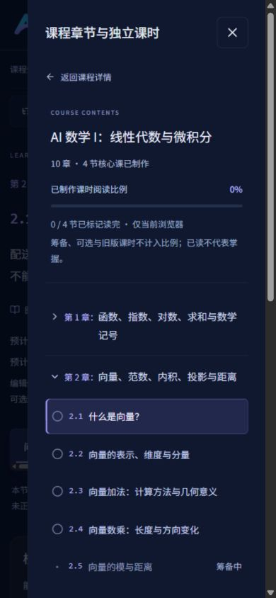
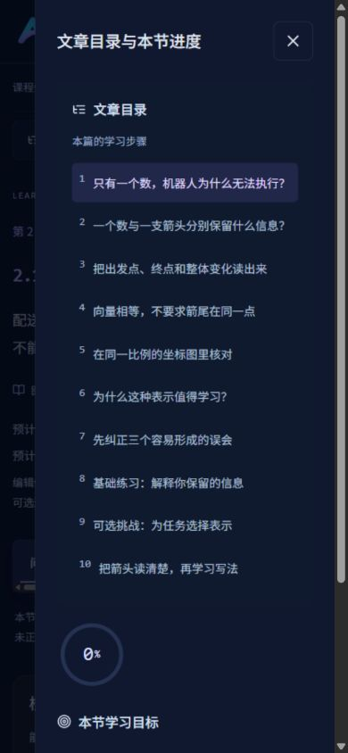

# Aivora V2.2：独立课时教材与目录验收报告

日期：2026-10-26（Asia/Shanghai）。开始时 fetch 核对远端 main 为 `9dc20af`；工作区 V2.1 成果先保存为独立提交 `5b992e3`，本轮继续在其上增量实施。

**本轮完成课程目录重构、MA 第 2–3 章详细规划，以及 2.1–2.4 四节完整试读。教材仍为 pending-review / preview，未开展独立人工教学审阅或目标学生试学。** 技术结果、字符统计与编辑判断均不作为正式教学质量达标证明。

## 1. 现状检查与范围

先阅读 V1.0 原始 Markdown / JSON、V2 计划与内容审查、V2.1 编写指南与验收、课程引擎、目录、路由、内容模型、阅读记录及相关 Next 本地文档，再打开实际 MA C03-L01 页面。初始页面见 [重构前截图](screenshots/teaching-v2-2/before-ma31.jpg)，检查与阶段计划见 [实施计划](TEACHING_V2_2_PLAN.md)。

发现左侧课程目录仍嵌入课时内的知识点，课程/文章两种导航混杂；缺少逐课完成图标与课程阅读概览；数学五篇试读仍偏概述，并且代码与数学基础的前置关系不够清楚。

本轮没有扩写 20 门课程，也没有把已有 PY/ML 试读仅因换了目录就宣称达到新的完整教材标准。数学后续课按照先修依赖与知识跳跃做了具体编辑评估，尚未完整制作的部分只显示筹备状态。没有虚构真实学生的难度、耗时或掌握数据。

## 2. 实际目录与界面

左栏顶部显示课程名、原规划的 10 章、当前已制作核心课数量、阅读比例及手动读完数。比例只统计现行已制作核心课，并明确排除筹备、整节可选与旧版教材，不是完整课程的认证完成率。

左栏只显示章和独立课时。当前课时高亮，完成图标只来自真实 `completed` 记录；没有记录时显示空心圆。章使用原生 details/summary，支持 Enter/Space、键盘焦点和克制的开合动画。文章目录从左栏移走，在桌面右栏和移动端独立“文章目录”Drawer 展示；“章节目录”Drawer 只列课时。

```text
AI 数学 I：线性代数与微积分
第 1 章：函数、指数、对数、求和与数学记号（节次规划中）
第 2 章：向量、范数、内积、投影与距离
  2.1 什么是向量？                         可试读
  2.2 向量的表示、维度与分量                 可试读
  2.3 向量加法：计算方法与几何意义             可试读
  2.4 向量数乘：长度与方向变化                可试读
  2.5 向量的模与距离                        筹备中，无链接
  2.6 向量内积                             筹备中，无链接
  2.7 向量投影与实际应用                     筹备中，无链接
  2.8 综合练习：向量建模与解释                筹备中，无链接
第 3 章：矩阵、转置、矩阵乘法与线性变换
  3.1 矩阵的概念与表示                      筹备中，无链接
  3.2 矩阵加法与数乘                        筹备中，无链接
  3.3 矩阵转置                             筹备中，无链接
  3.4 矩阵乘法：行与列的配对                  筹备中，无链接
  3.5 NumPy 矩阵实践（可选代码）              筹备中，无链接
  3.6 线性变换入门                         筹备中，无链接
第 4–10 章：保留 V1.0 原章级规划，未伪造节级正文
旧版教材与阅读历史：折叠区域，保留原五篇数学教材
```






上述桌面截图来自独立 `localhost:3001` 测试记录，展示旧稿已完成后新版仍 0/4；不是学生统计。真实完成图标的操作证据见 [完成截图](screenshots/teaching-v2-2/real-completion-icon.jpg)。其余页面与图解截图、逐项记录见 [浏览器结果](TEACHING_V2_2_BROWSER_RESULTS.json)。

## 3. MA101 规划与已制作地址

完整课时简报、稳定 ID、先修、例题、图解、验收和下一批难度评估见 [第 2–3 章详细规划](MA101_V2_2_OUTLINE.md)。原 V1.0 两份源文件不改写，哈希测试继续通过。

| 显示号 | 稳定 ID / 地址 | 本轮教学范围 |
| --- | --- | --- |
| 2.1 | `/learn/MA101/MA101-C02-L03` | 标量与向量、路线/路程/位移、自由平移与相等、零位移边界 |
| 2.2 | `/learn/MA101/MA101-C02-L04` | 分量顺序、正负和零、维度与下标、数据属性/单位对齐 |
| 2.3 | `/learn/MA101/MA101-C02-L05` | 分量配对、首尾相接、换起点、交换顺序、错序/单位错误 |
| 2.4 | `/learn/MA101/MA101-C02-L06` | 正/负/零与分数数乘、长度和方向、统一倍率、零分量边界 |

四篇使用连续的配送机器人位移情境。每篇核心正文均由自然段完整展开，包含为什么需要、具体计算、定义与符号、图解/理由、实际应用、错误与边界、开放练习、总结与后续衔接。正文一般约两千字符（只计核心 paragraph，不计图注、公式和答案），这个统计只是识别过短概述的辅助信息，**不是质量评分**。

每篇重点不同：2.1 不提前塞入运算；2.2 不要求转置；2.3 不把路程当合位移；2.4 从倍数与相似关系解释几何效果，不强制提前学习模公式。数学核心完全不要求 Python；2.2–2.4 的最小代码单独折叠，2.1 明确不安排代码实践。

## 4. 学习目标—练习映射

共 12 个核心目标，8 道核心开放题，另有 4 道可选挑战。每题保留两级提示、分步参考解答与自查 rubric；不以选择题代替计算/解释，也不提供 AI 评分。

| 课时与目标 | 核心验收题 | 实际要求 |
| --- | --- | --- |
| 2.1 判断标量/向量 | quantity-choice | 四个实际描述分类并说明方向依据 |
| 2.1 区分位移/路程/路线 | quantity-choice、same-displacement | 回到原点与绕路时分别保留哪些信息 |
| 2.1 判断平移后相等 | same-displacement | 比较三个不同起终点箭头的两方向变化 |
| 2.2 读取/书写分量 | read-components、build-record | 读取四维记录，写库存向量并保留零项 |
| 2.2 维度/编号/值 | read-components | 分别回答维度、a₂、a₄、−2 所在编号 |
| 2.2 检查可比较性 | build-record | 重排属性，指出单位换算要求 |
| 2.3 逐分量求和 | addition-new、addition-check | 新数字手算，米/厘米转换后求和 |
| 2.3 首尾相接解释 | addition-new | 中间点、最终点和合向量的画法 |
| 2.3 修正非法配对 | addition-check | 发现顺序/单位两类错误，说明同维条件 |
| 2.4 计算数乘 | scale-values、one-factor | 正倍数、负分数、零与统一倍率 |
| 2.4 长度/方向边界 | scale-values | 分别回答长度倍率、方向、零向量维度 |
| 2.4 判断单一倍率 | one-factor | 指出倍率冲突，不用除以零处理零分量 |

可选挑战分别是路线表示的局限、四维记录约定、补偿位移与避障边界、数乘对加法的分配关系。核心达标不依赖挑战。完整题干、目标、提示数量与评分项见 [内容矩阵](TEACHING_V2_2_CONTENT_MATRIX.json)，可用 `npm run review:teaching` 重建。

## 5. 图解、数学与代码核验

新增四类 SVG 教学图，共 8 个坐标面板：位移与路线/平移对照（2 个）、分量（1 个）、加法（1 个）、2/0.5/−1/0 数乘（4 个）。横纵轴一单位均映射为 29 个 SVG 单位；图示端点、数乘结果与可访问说明来自同一数值规则。零数乘只画点，不赋予方向；窄屏图保留最小可读宽度并支持局部键盘横向滚动，不拉伸坐标系。

数值输入和坐标映射见 [数学证据](TEACHING_V2_2_MATH_EVIDENCE.json)。独立测试核对平移不变、加法终点、单位/顺序转换、分配关系、数乘长度平方关系、方向符号与零分量；数学规则的讲解和几何理由仍在正文中，不靠测试替代推导。

| 检查 | 结果 | 证据范围 |
| --- | --- | --- |
| TypeScript | 通过 | 数据、通用组件、注册表与路由类型 |
| Lint | 通过 | 仓库 ESLint |
| 单元测试 | 48/48 | 含 5 类 V2.2 检查：新 ID/顺序、全部旧完成隔离、核心闭环/分层、目录空态、图形与数值 |
| Python | 21 个独立测试；37 个页面代码块逐个实际执行 | 新三段可选代码核对输出 `4 0 7`、`[2, 3]`、`[-6, -4]`，原 11 组核心/完整代码对照继续通过 |
| 公式/旧素材 | 全部公式严格 KaTeX 解析通过；原图片尺寸与下载同源检查继续通过 | 新 SVG 另查 title/desc、非有限坐标和等比例映射 |
| 构建 | 通过，50 个静态页面 | 23 个可读教材地址，非整门课发布证明 |
| HTTP | 69/69 | 全部课程/已制作课、10 个新筹备课与其他规划/非法路径的 404 |

执行详情：[Python 结果](TEACHING_V2_2_PYTHON_RESULTS.json)、[路由结果](TEACHING_V2_2_ROUTE_RESULTS.json)。数学参考核对使用 [OpenStax 向量章节](https://openstax.org/books/calculus-volume-3/pages/2-2-vectors-in-three-dimensions)，没有复制其例题文字或图像；本站配送情境与练习独立编写。

## 6. 浏览器验收与兼容

在实际生产构建服务中，以 1440×1000、768×1024、390×844、320×800 四个视口逐页检查全部 23 篇新旧教材，共 92 次；结果分批落盘。没有整页横向溢出、导航文字溢出、公式错误节点、失效页内 hash 或左栏文章链接。一次大批处理超时，超时结果未计入验收，已完整分批重跑。

另行操作：章 Enter/Space 开合、当前高亮、两种手机抽屉、Escape 后焦点回到触发按钮、文章抽屉关闭后焦点落到正文标题、两级提示与参考答案、代码折叠/复制、图形/公式局部滚动、上下节、旧链接、完成与刷新恢复、实时切换减少动态效果。减少动态效果测试发现旧缓存可能造成跳转仍平滑滚动，已修正为点击时直接核对媒体偏好，复验后目标立即定位在标题可见区域。

旧数学五篇 `C02-L01/L02`、`C03-L01/L02/L03` 的原 URL、contentVersion=1 和全部 section ID 保留。它们移入 legacy 区，不参与新目录显示编号、相邻课导航或新版进度。新四节 ID 为 L03…L06，不从旧记录复制任何状态。MA 默认入口改为新版 2.1；旧链接没有重定向到语义不同的新课。

完成状态操作使用与正常 `127.0.0.1` 分离的 `localhost:3001` 存储：五篇旧稿全部标记读完后，新版仍为 0%、0/4、无完成图标；标记新版第一节并刷新后为 25%、1/4、仅一个完成图标；进入下一节仍显示未完成。正常浏览器存储没有被清空或人为替换。

限制：视口模拟使用同一 Chromium 引擎，不等于实体手机、Safari/Firefox、触控或屏幕阅读器实测；部分内置浏览器截图在多次缩放后清晰度降低，交互与 DOM 数值证据另存，报告优先展示清晰截图。辅助完成记录属于验收操作，不是学生学习结果。

## 7. 待人工审阅与学生试学

| 尚需验证 | 建议观察方式 |
| --- | --- |
| 四节是否形成真正可独立学习的闭环 | 按方位/整数/分数先修筛选初学者，在无讲师补充时完成全文与新数字题，记录卡点和求助原因 |
| 2.1 位移与路线、2.2 编号与值是否真正区分 | 要求学生不用原话复述，再给不同起点、零分量和换序数据 |
| 2.3 公式与箭头是否能互相转换 | 先手画首尾相接图，再写分量计算；检查是否把中间箭尖坐标误认为第二向量 |
| 2.4 分数倍数、负倍数与零边界的负荷 | 分别问坐标、长度倍率、方向，观察是否把负号解释为负长度、把零视为某个方向 |
| 目标—练习的验收效度 | 人工按 rubric 看过程，不只看最终数；分别记录无提示、提示 1、提示 2 和答案后的表现 |
| 时间估计 | 分开计时核心阅读、独立练习、可选代码/挑战；数据足够后再校准区间，本轮无实测时间 |
| 下一批 2.5–2.8 和矩阵专题的实际难度 | 按详细规划逐篇制作和核验，结合试学再决定平方根/Σ/夹角/投影推导是否需要补修或进一步细分 |
| 无障碍与跨设备 | 用实体设备、屏幕阅读器及其他浏览器核对公式朗读、SVG 描述、滚动区域与 Drawer 焦点 |

正式发布前需独立人工审阅者复核数学、措辞、题目与评分标准，并根据目标学生试学修订。仍保持原产品边界：没有视频、AI 助手、运行时 AI API、支付或用户后台扩展，没有云端 Python 执行；Python 仅用于本地开发校验。
