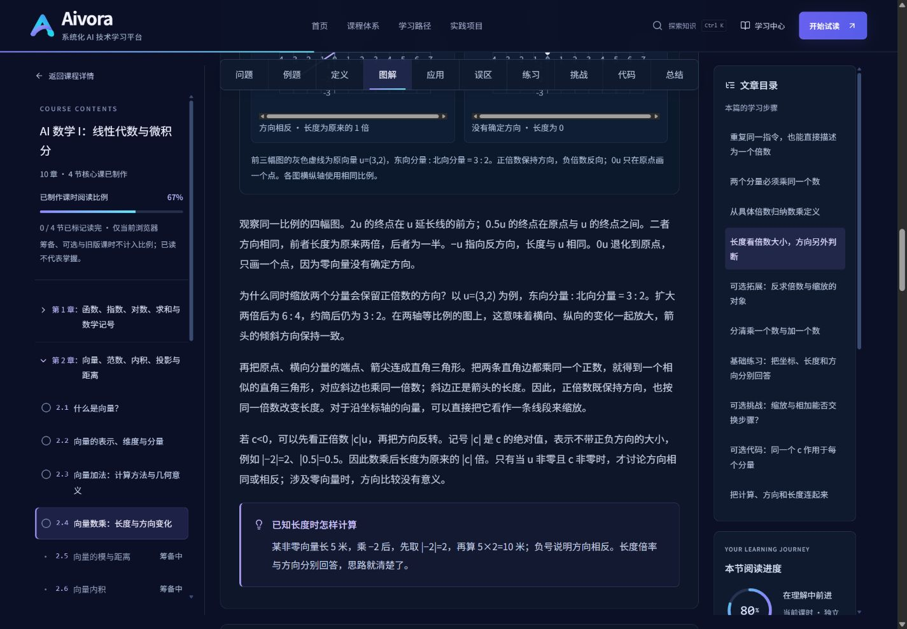
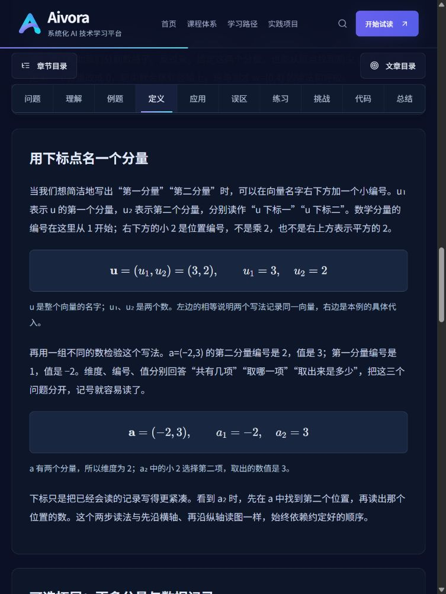

# Aivora V2.3：阅读节奏与教学结构精修报告

日期：2026-10-26（Asia/Shanghai）。基线：当前远端 main 的 V2.2 提交 `0f6fa0fffd6d52970413fd9f2cd0b3c2f546e60b`。本轮为增量教学编辑，没有重新搭建平台或扩写其他课程。

**已完成四节精修、通用标题排版调整及技术/浏览器验收。教材仍为试读、待人工审核；没有真实学生试学证据，不能据此认定理解效果或学习耗时已改善。**

## 1. 审核与前后证据

编辑前的问题及处理决定见 [现状审核](TEACHING_V2_3_AUDIT.md)。修改前先从实际数据保存了四篇完整教材，包含正文、公式、目标、题干、两级提示、参考答案、自查标准、section ID 与版本键。

- [V2.2 改前全文快照](TEACHING_V2_3_BEFORE.json)：固定基线，只写入一次，避免用新内容冒充旧稿。
- [四篇逐段前后全文对比](TEACHING_V2_3_COMPARISON.json)：每课包含 before、after、练习分层变化与锚点兼容结果；运行 `npm run review:editing` 可重建。
- [本轮目标—练习与层级矩阵](TEACHING_V2_3_CONTENT_MATRIX.json)：所有现有教材的结构快照，运行 `npm run review:teaching` 可重建。
- 原 V2.2/V2.1 报告和证据均保留，不覆盖历史结果。

同一 1440×1000 视口的改前/改后页面如下。截图中的阅读比例来自浏览器验收操作，是浏览记录，不是学习者统计或掌握程度。

| 改前 V2.2 | 改后 V2.3 |
| --- | --- |
|  |  |

## 2. 标题与导航

H1 仅展示课时标题；H2 展示主要教学环节的自然标题；H3 仅用于真实子内容，例如练习题、图解的多个对照面板、可选区中的不同专题。没有给普通段落加编号，也没有为了形式给每个环节补 H3。原有字号、色彩、卡片、段距与品牌资产继续承担视觉层级。

Reader 不再向 TeachingSection 传递显示编号；LessonHeading 只渲染标题。ArticleContents 移除 1、2、3 等索引，桌面与移动端共用同一实现。课程目录、面包屑、课时元信息和相邻课导航仍保留 2.1、2.2 等课时编号。

所有课时 ID、section ID、原练习 ID、URL 和 contentVersion=1 保持不变。没有修改显示编号工具来伪造身份，也没有重写 V1.0 章级事实或改动课程规划顺序。

## 3. 四节逐课编辑说明

| 课时 | 改前主要负荷 | 本轮修改 | 保留的教学支点 |
| --- | --- | --- | --- |
| [2.1 什么是向量？](http://127.0.0.1:3000/learn/MA101/MA101-C02-L03) | 场景后重复目标与未来知识；路线边界在例题、图后、应用、误区反复出现 | 在 worked 一次完整区分路线/路程/位移，加入折线路程 5 米；图后专心讲平移；误区改用东 3 再西 3 的具体回程 | 标量/向量、位移与路程、大小和方向、平移相等、零位移无确定方向；两道基础题与挑战保留 |
| [2.2 表示、维度与分量](http://127.0.0.1:3000/learn/MA101/MA101-C02-L04) | 初次读分量同时学习 n/i、列写法、四维数据、属性与单位对齐，基础题跨入建模 | 核心限定为二维分量读写、正负零、维度/编号/值和 u₁/u₂；一般记号、列写法及数据对齐全部保留在 application 可选区；两道基础题同步重编 | 图与 u=(3,2) 一致；用 (0,4)、(0,0)、三项零值记录解释维度；高维知识和原库存对齐任务仍可学习 |
| [2.3 向量加法](http://127.0.0.1:3000/learn/MA101/MA101-C02-L05) | 同一边界反复变成避障/未来运算警告；一般 n/i 与补零约定打断加法主线 | 保留逐分量推导、首尾相接、换起点与交换顺序的新信息；用具体中间点说明交换律；一般维度用三分量数字例子解释；补充厘米换米的实际步骤 | u+v=(2,3)，平移后 v 仍为 (−1,1)，新数字基础题和单位/顺序纠错；避障问题留在独立挑战 |
| [2.4 向量数乘](http://127.0.0.1:3000/learn/MA101/MA101-C02-L06) | 给定倍率的计算、反求倍率、共线、非原点位置缩放并列为必学；比例未声明顺序 | 核心围绕同一数乘每项、正负零、相似三角形与绝对值长度倍率；反求统一倍率、零分量判定、位置缩放/共线移到 application 可选区；补充新的基础纠错题 | 2/0.5/−1/0 四图及数值表、零向量意义；反求题 one-factor 与分配律挑战均保留，后者移除无前置的矩阵乘法追问 |

2.2 中原库存题涉及的属性顺序、零项、箱/件换算，保留为可选 `aligned-record`；原 `build-record` 锚点现在对应更基础的移动读写题。2.4 中原 `one-factor` 整题移入可选区，新基础题 `scale-explain` 验收计算错误辨析与已知长度的变化。没有保存过的用户练习答案需要迁移：练习输入仍仅在当前页面暂存。

## 4. 合并、删除与保留的边界说明

| 原位置与重复提醒 | 处理 | 为什么不影响准确性 |
| --- | --- | --- |
| 2.1 scene：“本节结束时…后面两节…不要求一次学会” | 删除正文中的重复任务/未来知识声明 | 目标已在课前目标区给出；正文直接进入标量与箭头 |
| 2.1 worked、diagram、application：反复讲路线不是位移、向量未承诺保存路径 | 合并到 worked 的完整解释；图注保留实线/虚线含义 | 首次区分更完整，保留路程 5 米与绕路例子；图后只引导比较两支箭头 |
| 2.1 definition：力的作用位置等物理例外；另一个“大小相同还不够”提示框 | 删除离开位移主线的例外和重复框 | 定义已限定平面位移/自由向量；反向箭头仍是明确反例，未把所有物理量都宣称可自由平移 |
| 2.1 mistakes：再次列举前面三条提醒、再次预告后续课 | 改成东 3 再西 3 的 6 米路程/零位移例题 | 零向量无确定方向仍完整解释，并明确“回到起点”与“一直静止”的差别 |
| 2.2 worked 图后：再次回看路线；scene/definition 多次提未来矩阵/标准化 | 图后改为读格子与改变零分量；复杂表示留在可选区一次说明 | 核心读图不需要再次讨论避障；列写法的行列形状条件仍在相应拓展旁说明 |
| 2.2 mistakes/application/summary：重复三项检查、嵌入约定和高维不能画地图 | 核心用顺序与维度的具体对比；数据/单位的边界只在可选应用解释 | 对齐没有被删除；基础目标不再依赖可选单位任务 |
| 2.3 worked/图注：程序打印相同不证明结果、把所有数字相加不是向量 | 前者删除，后者在 scene 已说明，公式图注专注分量对应 | 独立位置追踪与方向预测仍保留，数学核对并未减弱 |
| 2.3 application：交换律之后重复“不能推断避障/不推广未来运算” | 用两种中间点 (3,2)、(−1,1) 与同终点 (2,3) 精确说明 | 保留交换的对象与路线差别；避障仅在挑战提出，不在每段附免责声明 |
| 2.3 diagram/definition：第二种平行四边形法、通用 n/i 和补零嵌入 | 本课只用已图示的首尾相接；三维例子代替一般下标，基础答案只解释缺少对应项 | 不省略本课的逐分量推导；一般 n/i 仍在 2.2 可选区；没有暗中把二维与三维直接相加 |
| 2.3 mistakes 的三项检查框、代码后的输入验证警告 | 合并前者到具体换序/换单位例子；后者换成输出与两项计算的对应 | 顺序/单位/同维条件均留在正文与题目；代码本身未修改，也未宣称新增输入验证 |
| 2.4 scene/definition/mistakes/summary：反复“长度以后讲”“不能算负长度”“未来还有边界” | 把绝对值与零方向集中在图解和长度例子；数乘/加法错误单独具体解释 | 相似三角形理由、非零方向条件和零向量均保留；总结仍回顾这些核心结论 |
| 2.4 application 的复杂位置/统一倍率边界；挑战中的矩阵规则警告 | application 明确折叠为可选；挑战专注数乘分配关系 | 知识保留，基础不强制；两分量的一般分配律理由更完整，没有借用未学矩阵概念 |

总结和参考答案中的简短回顾是自查所需，不按词频机械删除。真正的新误解，例如平移后的箭尖位置不是 v 的分量、零数乘无方向、交换顺序改变中间点，仍在产生误解的地方解释。

## 5. 核心目标—基础练习对应

四节仍为 12 个核心目标、8 道核心开放题；另有 6 道可选题。两级提示、参考解答和 rubric 均保留；可选题不参与基础目标映射。

| 课时 | 核心目标 | 基础练习 ID |
| --- | --- | --- |
| 2.1 | 判断标量/向量并说明方向依据 | quantity-choice |
| 2.1 | 区分整体位移与路线、路程 | quantity-choice、same-displacement |
| 2.1 | 通过平移判断位移相等 | same-displacement |
| 2.2 | 按东、北约定读写二维分量 | read-components、build-record |
| 2.2 | 区分维度、编号和值 | read-components |
| 2.2 | 解释正、负、零分量 | build-record |
| 2.3 | 在统一方向/单位下逐分量求和 | addition-new、addition-check |
| 2.3 | 用首尾相接解释起终点 | addition-new |
| 2.3 | 发现维度、顺序、单位错配 | addition-check |
| 2.4 | 每项乘同一个数，区别数乘/加数 | scale-values、scale-explain |
| 2.4 | 解释正、负、零的方向意义 | scale-values |
| 2.4 | 用绝对值判断长度倍率 | scale-values、scale-explain |

可选题：route-record、aligned-record、schema-record、missing-leg、one-factor、scale-sum。技术映射检查只能证明目标与题目有关联；题目是否足以验收理解，仍待人工看答题过程和目标学生试学。

## 6. 数学、图解和代码复核

| 复核对象 | 结果与证据 |
| --- | --- |
| 明确比例顺序 | 东向:北向=3:2；2u=(6,4)，6:4 约简仍为 3:2。正文、表格、SVG 端点与图注一致，未改成错误的坐标顺序 |
| 基础数值与答案 | 分量/维度/零项、三分量加法 (4,1,4)、50 厘米=0.5 米、往返 6 米/零位移、负半倍/零倍、长度 5×|−2|=10 米均独立核对 |
| 核心推导 | 加法保留逐方向变化→一般二维分量；数乘保留重复移动→逐分量定义→正比例/相似三角形→负号与绝对值。未用代码输出替代几何解释 |
| 原 SVG | 四类、8 个坐标面板及横纵等比例映射保持不变，零倍数只画点；仅精修数乘图注，移除“同一计算函数生成”的实现细节 |
| 公式 | 现有全量严格 KaTeX 解析测试通过；实际页面未发现 katex-error。所有新/改公式均附符号解释和数值代入 |
| Python | 四篇的三段可选代码与 V2.2 逐字相同；全站 37 段页面 Python 均实际执行，11 组核心/完整实现对照继续通过 |

详见 [数学数值证据](TEACHING_V2_3_MATH_EVIDENCE.json)、[Python 执行证据](TEACHING_V2_3_PYTHON_RESULTS.json)、`tests/test_math_v2_2.py` 与新增 `tests/test_teaching_v2_3.py`。参考解答已逐题与题干设定核对，不把独立数值测试等同于人工教材审校。

## 7. 技术与浏览器验收

| 检查 | 结果 |
| --- | --- |
| TypeScript / ESLint | 均通过 |
| TS 单元测试 | 52/52；含全部教材标题/目录契约、四篇 r1/锚点/代码兼容、目标分层、比例排序 |
| Python 单元测试 | 25/25；新增分量/比例/长度/单位答案检查；原数学验证继续执行 |
| 生产构建 | 通过，50 个静态页面；未更改发布审核状态 |
| HTTP | 69/69；现有可读路由、规划/错误归属 404，见 [路由记录](TEACHING_V2_3_ROUTE_RESULTS.json) |
| 重点教材排版 | 四篇×1440×1000、768×1024、390×844、320×800，共 16 次；无整页溢出、空 hash 或公式错误节点 |
| 全部教材语义回归 | 23 篇均为单一 H1；正文 H2 无生成编号；无空标题或文章内 H2/H3/H4 跳级 |
| 交互 | 桌面文章目录、平板定义链接、手机文章/课程 Drawer、Escape 焦点恢复、可选内容展开、两级提示/参考答案键盘操作、SVG 局部键盘横滚均检查 |

浏览器操作详见 [浏览器记录](TEACHING_V2_3_BROWSER_RESULTS.json)，截图目录为 `docs/screenshots/teaching-v2-3/`。所有浏览器检查使用实际生产构建，改前截图使用当时的 V2.2 开发页。视口模拟使用同一 Chromium，引擎/实体设备/屏幕阅读器覆盖不由此推定。

原始输出：[单元测试](TEACHING_V2_3_TEST_RESULTS.txt)、[生产构建](TEACHING_V2_3_BUILD.txt)。用户原先启动的 3000 开发服务保留，本轮启动的 3001 生产验收服务在验收后停止。

| 平板正文 | 手机文章目录 | 手机课程目录 |
| --- | --- | --- |
|  |  |  |

## 8. 链接、阅读和完成状态兼容

四篇原 40 个 section ID 全量保持，原 12 个 exercise ID 均保留，课程稳定 ID 和 r1 存储键不变。对比脚本在丢失旧 section/练习或改变版本时会失败。自动化逐一检查原 section 的完成与未完成记录、比例和当前位置均仍可解析。

实际操作验证：

- `#definition` 定位到无编号 H2，桌面/平板/手机导航继续工作。
- `#application` 和 `#exercise-one-factor` 自动展开新的可选区；后者定位到原练习标题，不因折叠而成为失效书签。
- 上一轮 `localhost:3001` 隔离验收保存的 2.1 完成状态继续显示“本节已读完”、1/4 完成；进入 2.2 仍显示“标记本节已读完”，没有跨节复制。
- 2.2 阅读到 definition 后刷新，保留 `#definition` 与“回到上次位置”链接；没有清空或替换浏览器存储。
- 旧 `MA101-C03-L01#matrices` 可读、可定位，原旧稿完成状态保留；旧五篇仍不计入新版分母。全部旧 URL 继续通过 HTTP 检查。
- 章节 Enter/Space 展开/收起、当前高亮与相邻课切换工作正常；筹备课仍没有伪造正文链接。

这些完成记录属于工具验收，不是学生数据。标题/措辞精修没有触发进度重置；已有“读完”也不被描述为掌握了新题。

## 9. 待人工审阅与真实试学

需要独立人工审阅者复核表达、公式、图注、题干/答案和 rubric。真实初学者试学应重点观察：能否独立区分位移/路程；2.2 能否区分维度、编号和值并保留零项；2.3 能否在图与分量之间转换；2.4 是否把负倍数误认为负长度；是否会被可选区打断核心阅读；新基础题在无提示/提示后分别能验收到什么。

学习时间继续标为编辑估计，本轮没有按字数变化推算节省分钟数。未设置新的强制字数/段数目标，并撤去旧段数数量断言；完整解释、数学准确性和题目效度仍需人工与学生证据，不能由生成成功、测试通过、截图或本报告证明。

未改变主页、品牌、V1.0 章级事实与其余课程内容；未制作视频，未增加 AI、运行时模型 API、支付、用户后台或云端代码执行。
