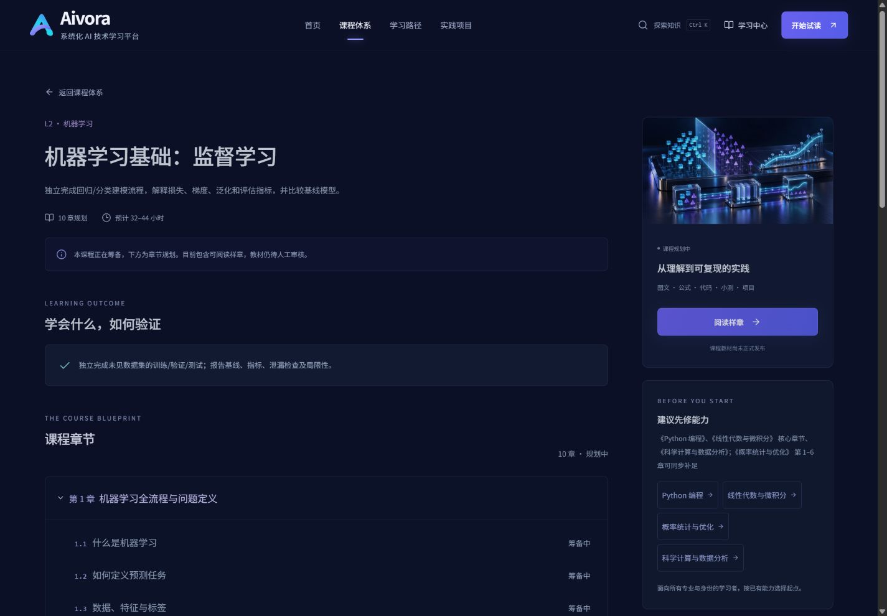
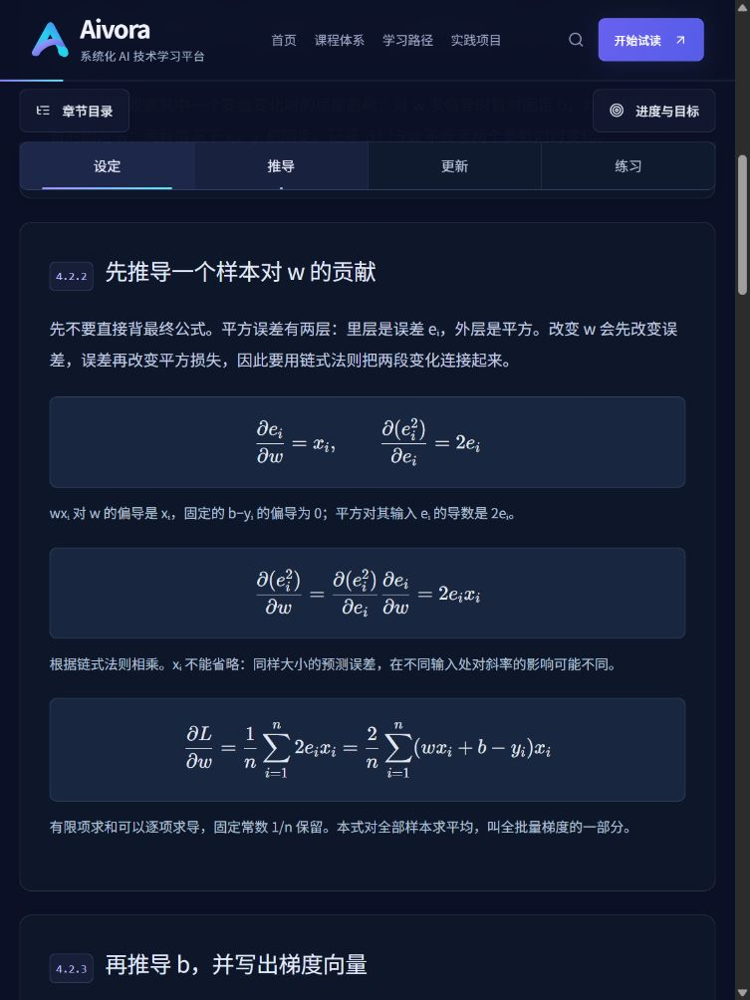
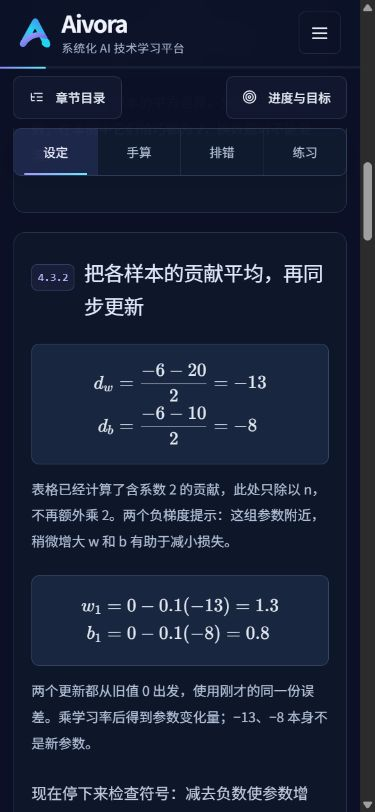
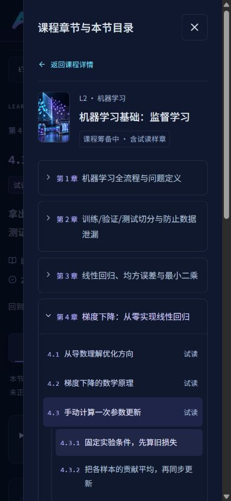

# 教材 V2 与分层目录验收记录

日期：2026-10-25。实施计划见 [TEACHING_V2_PLAN.md](TEACHING_V2_PLAN.md)。

## P0：检查与保护原数据

两份新增规范已逐节阅读；V1.0 仍为原始章级事实。现有样章 ID/URL/段落/下载与 v1/v2 记录保持不变，旧完成状态不能推导新版完成。基线 TypeScript、ESLint、28 项测试通过。

先编写 P0 兼容测试：2 项通过，验证旧样章七锚点与完成记录不迁移七节新 ID。目录测试先出现预期的模块不存在失败，再添加独立编号与蓝图实现转绿；不是先迁移再补断言。起始 Next 自动生成的开发路径改动单独保留，不纳入业务提交。

## P1：分层数据与一致显示

新增独立节级蓝图与纯显示编号函数，保留全部 20 门课程章级顺序和源标题。详情、阅读器侧栏与抽屉使用 CourseContents，同章真实课时/规划课时明确区分；规划条目无 href。独立导航的知识单元使用 n.m.k；旧综合试读保留原锚点、标题采用普通小标题，不再重复 01/02。

ML201 第 3 章 3.1–3.4、第 4 章 4.1–4.6 的节级结构已建立。C04-L01 保留给旧版，C04-L05 的显示号为 4.4，证明稳定 ID 与显示序号无耦合。PY/MA 既有样章分别为 5.1 / 3.1。尚未设计具体节次的其他章节显示“节次规划中”，不虚构内容。

编号同步到正文标题、面包屑、目录、相邻课时、搜索结果、卡片入口与学习中心。旧版历史保留，课程进度统计排除旧版，以避免单节旧记录冒充新版章节完成。

阶段验证：TypeScript 通过，当前全部 33 项测试通过（原 28 项 + P0/P1 新 5 项）。P2–P4 的教材、代码与浏览器结果在完成后补充，当前不将目录结构视作教材完成。

## P2：七节教学草稿与质量门槛

已完成真实正文：3.1 回归任务、3.2 模型、3.3 损失、4.1 导数、4.2 梯度、4.3 手算、4.4 NumPy。每节有先修检查/补修、可观察目标、5 个知识单元、数字例题、代码及解释、2 个理解自查、2 个带分层提示/参考答案/Rubric 的开放练习、总结与衔接。不是把旧短样章简单加长；旧综合页独立保留。

新增 table / reading-links / exercise 内容块，不改 React 页面即可生产同类教材。5 张原创精确图各有桌面/手机 PNG 构图；2 组新 Python/Notebook 下载从网页代码同源生成。完整数值、每节检查点、官方来源与许可处理见 [逐节内容质量记录](TEACHING_V2_CONTENT_REVIEW.md)。原 3 组下载、原 3 节正文与测试保留。

实施中先登记 draft/private，完成 Python 执行和严格公式解析后改为 pending-review/preview。未填写人工 reviewEvidence，也未声称正式发布或学生试学通过。3.4、4.5、4.6 和其他未写课时保持不可点击的筹备条目；没有为填满目录虚构正文。

## P3：扩展、兼容与呈现

- `course-outline` 保存节级蓝图；`course-directory` 组合原课程、蓝图与发布清单；编号函数生成章/节/知识单元显示号。CourseContents 复用于详情、左栏、手机抽屉，Reader/ContentRenderer 不认识具体 ML 课时。Course→Chapter→Lesson→Section→Block 的职责与新增课时步骤已更新到 [编写指南](COURSE_AUTHORING.md)。
- 原 ML201-C04-L01 r1、7 个段落锚点、v1/v2 存储与下载均保留。旧综合试读标注 legacy，排除新版课程完成率，保留最近阅读入口。没有把一个旧读完记录迁移到七节新课。
- 新 ID 与展示号解耦：C04-L02 显示 4.1，C04-L05 显示 4.4。首页/导航主入口改为新版 3.1；原绝对地址仍有效。编号同步面包屑、标题、目录、搜索、卡片试读和学习中心。
- 继续使用现有按课程/课时/修订存储、RAF 滚动、Motion 与减少动效支持。没有新动画依赖、在线 Python、视频、AI 助手、AI API、认证、支付或数据库。练习输入仅当前页面暂存，答案与读完标记独立。
- 浏览器发现旧 summary 的通用 flex 规则让章标签占一半宽度；收窄为仅章标题 flex，避免叠加重复覆盖。手算成对公式改为上下排列；表格和长代码局部滚动，不缩小整页文字。保留深海军蓝/Indigo/Violet/Cyan 品牌与封面。

## P4：实际自动检查

环境：Node 24.16.0、npm 11.13.0、Python 3.14.2、NumPy 2.5.2、Matplotlib 3.11.2；Next 16.4.3。相关 Next 安装包动态路由文档已在修改前阅读，保留 async params 与静态权限路由。

| 检查 | 结果 / 证据 |
| --- | --- |
| TypeScript `npm run typecheck` | 通过 |
| ESLint `npm run lint` | 通过，无错误警告 |
| `npm test` | 38 项全部通过；原 28 项保留，新 10 项覆盖兼容/层级/教学组件/链接/完成率等 |
| `npm run test:python` | 13 项单元测试 + 15 个网页 Python 代码块实际运行通过，[stdout/stderr](TEACHING_V2_PYTHON_RESULTS.json) |
| `npm run build` | 通过，37 个静态生成条目；包含 20 个课程详情、10 个阅读地址 |
| `npm run test:routes` | 实际生产服务 46/46 通过，含所有课程/真实正文及规划/未知/错误课程归属的 404，[逐地址结果](TEACHING_V2_ROUTE_RESULTS.json) |
| 原事实文件 | V1.0 Markdown 与 JSON 的 SHA-256 与基线一致，测试保护原始字节 |
| 下载 | 5 组脚本/Notebook 与网页完整代码逐字同源；无伪造 Notebook 输出；浏览器真实下载新 .py 并与复制内容相等 |

中间失败已处理：新增发布条目改变了旧测试夹具的数组首项，触发错误章 ID 时先报“蓝图不一致”；将引擎验证顺序调整为先校验有效课程/章节，再校验节级蓝图，保留原“无效章节”断言与语义。没有删除失败测试或降低验收条件。

## 真实浏览器验收

在 IAB Chromium 对本机**生产服务 3001** 操作，分别使用桌面 1440×1000、平板 768×1024、手机 390×844，并加测 320×740。逐节打开七个新版正文；旧 ML、PY、MA 亦检查。构建与 HTTP 检查不替代下列 UI 实测。

已保存 17 条布局测量与 34 张截图（包括两张明确标注 before-fix 的目录修复前证据）。完整交互记录与截图清单见 [浏览器证据](TEACHING_V2_BROWSER_RESULTS.json)，文件在 [screenshots/teaching-v2](screenshots/teaching-v2/)。

| 场景 | 实测 |
| --- | --- |
| 新教材桌面 / 手机 | 七节标题、章节与知识单元一致，无重复 01；无 KaTeX 错误；正文 16px，均无整页横向溢出 |
| 平板 / 窄屏 | 768px 推导与导航正常，320px 长标题不撑宽页面 |
| 手机触控 | 目录与进度按钮分别约 112×44 / 125×44px；内容导航高 48px |
| 目录定位 | 4.3.2 点击后抽屉关闭、h2 得到焦点；Escape 关闭后焦点回到“章节目录” |
| 跨章上下节 | 3.3→4.1，上一节回 3.3；未制作的 3.4 无正文链接；4.4 无虚构下一节 |
| 原样章兼容 | 旧 /ML201-C04-L01#gradient 可定位，原已读完仍可见；新 3.1 初始未读完 |
| 独立记录 | 手动标记 3.1 后 3.2 仍未读完；学习中心新版显示 1/7，旧记录仍列在历史中。未清除任何已有站点记录；验收在 3001，交付时打开 3000 新版页会按正常逻辑记录本次访问 |
| 表格与图片 | 390px 表格局部 client=308/scroll=640，键盘两次右箭头 scrollLeft=80；手机加载独立 640×680 配图，展示约 308×327px |
| 测验 / 开放练习 | 错误选项显示原因与参考答案；改选清除旧反馈；输入、提示、参考解答/Rubric 可操作，不自动标记读完 |
| 复制 / 下载 | 完整 NumPy 脚本复制成功，实际下载的 .py 与剪贴板逐字一致 |
| 搜索 | Ctrl+K 真正聚焦“搜索课程”；搜索 4.3 出现正确编号与标题，点击进入稳定 C04-L04 地址 |
| 状态 / 无效路径 | 页面始终说明试读待人工审核；直接访问规划 3.4 为品牌 404 |
| 减少动效 / 日志 | reduce=true 时 scroll-behavior=auto，测试后恢复媒体模拟；检查点没有应用 warn/error |

重点截图：

## 尚未完成与后续门槛

1. 七节仍需专业人工审稿和目标学习者试学；未把代码通过当作教学达成证明。逐节需审的教学问题见质量记录，审核后方可填 reviewEvidence 并进入后续状态。
2. 3.4、4.5、4.6、第 1/2 章及其他大多数课程正文仍在规划。无明确节级设计的章节显示“节次规划中”，未编造整套教材。
3. 本轮测试覆盖 Chromium 与指定视口，没有宣称完成 Safari/Firefox、真实手机硬件或屏幕阅读器人工测试。
4. 记录仍仅本地浏览器；开放题输入不持久保存，无 AI 批改、云同步或证书。
5. 原品牌与大部分历史样式保留；本轮仅整理与目录/教材块相关规则，没有无必要重写整个网站。

所有 V1.0 原始事实、有效旧功能、旧测试与历史证据保留；两份新标准作为本轮项目输入一并入库。没有批量删除文件或目录。
